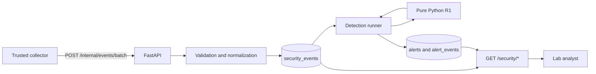

# Security Monitoring and Investigation Platform

A portfolio-scale security monitoring lab built around a fictional document-sharing
application. The project is designed to build practical skills in structured event
handling, detection engineering, Python, SQL, APIs, and security investigation.

> **Status:** Days 1–6 are complete. Security events are validated, ingested through a
> collector-only API into PostgreSQL, evaluated by a deterministic
> failed-logins-followed-by-success detection, and stored as deduplicated alerts linked
> to their raw evidence. Analyst-only endpoints expose events, alerts, and evidence. The
> second detection and the document application remain planned.

## Current capabilities

- A versioned security-event contract with event-specific validation
- Deterministic JSONL parsing, normalization, replay handling, and error reporting
- R1: five failed logins followed by a success within ten minutes
- PostgreSQL storage with constraints, foreign keys, and SQL migrations
- Trusted batch ingestion that stores replays once and rejects conflicting event IDs
- Replay-safe alert storage: rerunning the detector never duplicates an alert
- Alert-to-event evidence links and a recorded history of detector runs
- Separate collector and analyst credentials enforced on every endpoint
- Behavioral, persistence, API, and authorization tests against real PostgreSQL

Walkthroughs of the code and data flow:

- [Days 1–4: parsing and the R1 detection](docs/DAYS_1_4.md)
- [Days 5–6: PostgreSQL, persistence, and APIs](docs/DAYS_5_6.md)

## Architecture



PostgreSQL stores facts; the detector decides whether those facts are suspicious.
Detection functions remain independent of HTTP and database code, so the same rule runs
from the file-based CLI and the database-backed runner.

## Core stack

- Python for event processing and detection logic
- PostgreSQL (Docker Compose) and `psycopg` with parameterized SQL
- FastAPI for trusted ingestion and investigation reads
- pytest for behavioral tests
- React and TypeScript for the planned document and investigation interfaces

The local project remains runnable without Splunk or AWS.

## Run it

Python 3.10 or newer and Docker are required.

```bash
python3 -m venv .venv
source .venv/bin/activate
python -m pip install -e '.[dev]'

cp .env.example .env    # then set a password and generate both tokens
docker compose up -d --wait
python -m scripts.migrate
python -m scripts.migrate --database-url-env TEST_DATABASE_URL

python -m pytest
```

Demonstrate the pipeline (API in one terminal, commands in another):

```bash
uvicorn backend.api:create_app --factory

python -m scripts.replay_events fixtures/days_1_2.jsonl
python -m scripts.run_detection
python -m scripts.run_detection   # second run: alerts_unchanged=1, nothing created
```

The file-only tools from Days 1–4 still work without a database:

```bash
python -m scripts.parse_events fixtures/days_1_2.jsonl
python -m scripts.detect_r1 fixtures/days_1_2.jsonl
```

To wipe local data and start over: `docker compose down -v`, then repeat the Compose and
migration steps. See the [Days 5–6 walkthrough](docs/DAYS_5_6.md) for endpoint examples.

## What is next

Days 7–9 add login, two organizations, document routes with server-side ownership
checks, server-generated login and denied-access events, and R2.

See [Technical specification](docs/TECHNICAL.md) for the data contract, security model,
and rule specifications. See [Project roadmap](security_project_roadmap.txt) for the
planned milestones and release scope.

## Scope

This is a controlled portfolio lab, not a production SIEM or professional SOC
experience. Its threshold detections identify activity worth investigating; they do not
prove account compromise or data exfiltration. Fixtures contain only fictional data and
must never include credentials, tokens, cookies, or document contents.
