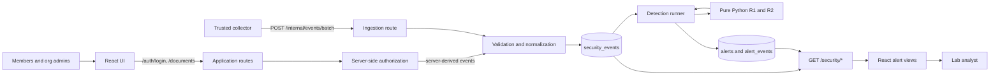

# Security Monitoring and Investigation Platform

A portfolio-scale security monitoring lab built around a fictional document-sharing
application. The project is designed to build practical skills in structured event
handling, detection engineering, Python, SQL, APIs, and security investigation.

> **Status: v0.1 release candidate.** A small document application with two fictional
> organizations authenticates users and enforces tenant and ownership rules on the
> server. Its login and authorization decisions become trusted security events, stored in
> PostgreSQL alongside collector-ingested events. Two deterministic detections run over
> those events: failed logins followed by success (R1), and repeated denied document
> access (R2). Their results are stored as deduplicated alerts linked to raw evidence and
> exposed only to the lab analyst, who follows each alert to its supporting events in a
> minimal React interface. A fresh checkout reproduces both detections and their benign
> counterparts through the real application routes. The remaining v0.1 item is the
> recorded demo.

## Current capabilities

- A versioned security-event contract with event-specific validation
- Deterministic JSONL parsing, normalization, replay handling, and error reporting
- Local authentication: Argon2id password hashes and opaque, expiring, revocable
  database-backed sessions
- Two organizations with member, organization-admin, and lab-analyst roles; document
  create/read/update through the API with server-side ownership and tenant isolation
- Server-generated `login_failed`, `login_succeeded`, `access_denied`, `document_created`,
  and `document_updated` events; successful changes commit with their audit event
- R1: five failed logins followed by a success within ten minutes
- R2: five distinct denied documents within five minutes, grouped into one episode with a
  15-minute inactivity cooldown
- PostgreSQL storage with constraints, foreign keys, and SQL migrations
- Trusted batch ingestion that stores replays once and rejects conflicting event IDs
- Replay-safe alert storage: rerunning either detector never duplicates an alert
- R2 late-event reconciliation: current alerts match full-history episodes while
  superseded alerts retain their evidence and analyst status
- Alert-to-event evidence links and a recorded history of detector runs
- Three separate trust domains: application sessions, lab-analyst sessions, and a
  collector credential
- Behavioral, persistence, API, and authorization tests against real PostgreSQL,
  including cross-user, cross-organization, admin-scope, analyst-only, and benign
  below-threshold cases
- A React and TypeScript client: login, read-only document list/detail, and an analyst
  alert list with filters and an alert detail page showing the reason, threshold check,
  and time-ordered raw evidence; authorization stays entirely server-side
- Scripted suspicious and benign scenarios through the real routes, a telemetry reset, and
  a GitHub Actions workflow that runs the backend and frontend checks on every push and
  pull request

Release evidence:

- [Investigation: failed logins followed by success for Alice](docs/investigations/R1_alice_failed_logins.md)
- [Demo recording script](docs/DEMO.md)
- [Days 12–14: release hardening and reproducibility](docs/DAYS_12_14.md)
- [Hardening section 1: baseline and recovery evidence](docs/hardening_baseline.md)

Walkthroughs of the code and data flow:

- [Days 1–4: parsing and the R1 detection](docs/DAYS_1_4.md)
- [Days 5–6: PostgreSQL, persistence, and APIs](docs/DAYS_5_6.md)
- [Days 7–9: authentication, documents, application events, and R2](docs/DAYS_7_9.md)
- [Days 10–11: the React document and investigation interface](docs/DAYS_10_11.md)

## Architecture



The React client is a thin view over the API. It hides irrelevant navigation per role,
but every request carries the session token and FastAPI decides what it may return.

PostgreSQL stores facts; the detector decides whether those facts are suspicious.
Detection functions remain independent of HTTP and database code, so the same rule runs
from the file-based CLI and the database-backed runner.

## Core stack

- Python for event processing and detection logic
- PostgreSQL (Docker Compose) and `psycopg` with parameterized SQL
- FastAPI for the document application, trusted ingestion, and investigation reads
- `pwdlib[argon2]` for password hashing; opaque database-backed sessions
- pytest for behavioral tests
- React, TypeScript, React Router, and Vite for the document and investigation interface;
  Vitest and Testing Library for its tests
- GitHub Actions for continuous test runs

The local project remains runnable without Splunk or AWS.

## Set up from a fresh checkout

Requires Python 3.10+, Node.js 24.15+, and Docker.

```bash
git clone <repository-url> && cd project_detection
python3 -m venv .venv
source .venv/bin/activate
python -m pip install -e '.[dev]'

cp .env.example .env
```

Edit `.env`; nothing in it is committed:

- `POSTGRES_PASSWORD`: any local password. Use the same value inside `DATABASE_URL` and
  `TEST_DATABASE_URL`.
- `COLLECTOR_TOKEN`: at least 16 characters, for example
  `python -c "import secrets; print(secrets.token_urlsafe(32))"`.
- `SEED_USER_PASSWORD`: at least 12 characters; every seeded fictional user signs in
  with it.

Create the schema, load the known starting data, and run every check:

```bash
docker compose up -d --wait                                     # PostgreSQL 17
python -m scripts.migrate                                       # schema: security_lab
python -m scripts.migrate --database-url-env TEST_DATABASE_URL  # schema: security_lab_test
python -m scripts.seed                                          # fictional orgs, users, documents

python -m pytest                                                # backend, against PostgreSQL
cd frontend && npm ci && npm test && npm run typecheck && npm run build && cd ..
```

Migrations define the database structure; the seed fills it with the fictional
organizations, users, and documents every scenario starts from. If `pytest` reports
database tests as skipped, PostgreSQL or `TEST_DATABASE_URL` is not reachable.

Seeded accounts (all use `SEED_USER_PASSWORD`):

| Login | Role | Organization |
| --- | --- | --- |
| `alice@alpha.example.test` | member (owns `doc-alpha-001..003`) | `org-alpha` |
| `bob@alpha.example.test` | member (owns `doc-alpha-004`) | `org-alpha` |
| `admin@alpha.example.test` | organization admin (owns `doc-alpha-005`) | `org-alpha` |
| `dana@beta.example.test` | member (owns `doc-beta-001..003`) | `org-beta` |
| `admin@beta.example.test` | organization admin (owns `doc-beta-004`) | `org-beta` |
| `analyst@lab.example.test` | lab analyst | none |

## Reproduce the detections

Start the API and the UI in two terminals:

```bash
uvicorn backend.api:create_app --factory     # http://127.0.0.1:8000
cd frontend && npm run dev                   # http://127.0.0.1:5173, proxies /api
```

In a third terminal, generate activity through the real application routes, then run the
detectors:

```bash
python -m scripts.reset_telemetry --yes             # start from empty telemetry
python -m scripts.generate_scenarios suspicious
python -m scripts.run_detection                     # R1 created 1, R2 created 1
python -m scripts.run_detection                     # rerun: created 0, unchanged 1 each
```

`suspicious` signs Bob in, opens his own `doc-alpha-004`, and requests
`doc-alpha-001`, `-002`, `-003`, `-005` (`403`) and `doc-beta-001` (`404`): five distinct
denied documents. It then fails five logins for Alice and signs her in correctly.

Each detector prints its own run ID, rule configuration, scanned range, event and alert
counts, duration, and outcome. If one rule fails, the command reports the other rule's
outcome separately and exits nonzero. A crashed worker may leave a `running` row; the next
runner marks it `abandoned` after taking the exclusive runner lock. The persisted failure
field contains a safe category, not exception text. See the
[baseline and recovery report](docs/hardening_baseline.md) for test evidence.

Sign in to the UI as `analyst@lab.example.test`, open **Alerts**, and follow each alert to
its evidence. The script checks every HTTP status and stops at the first unexpected one.

The benign counterpart must start from empty telemetry, otherwise the earlier alerts are
still listed:

```bash
python -m scripts.reset_telemetry --yes
python -m scripts.generate_scenarios benign
python -m scripts.run_detection                     # R1 and R2 both detect 0
```

`benign` fails four logins for Alice before her success (below R1's threshold) and has
Bob request the same document five times (one distinct document, below R2's threshold).

The collector path and the file-only tools from Days 1–4 still work:

```bash
python -m scripts.replay_events fixtures/days_1_2.jsonl   # needs the API running
python -m scripts.parse_events fixtures/days_1_2.jsonl
python -m scripts.detect_r1 fixtures/days_1_2.jsonl
```

## Reset

| Goal | Commands |
| --- | --- |
| Replay a scenario from the same starting state | `python -m scripts.reset_telemetry --yes` |
| Rebuild everything from nothing | `docker compose down -v`, then the Compose, both migrate, and seed steps above |

`reset_telemetry` deletes events, alerts, replacement links, evidence links, detector runs, and sessions from
the `DATABASE_URL` database and keeps the seeded organizations, users, and documents.
Without `--yes` it only names the target database. `docker compose down -v` deletes the
PostgreSQL volume, including the test database. Neither requires editing PostgreSQL by
hand.

## Known limitations

- Local lab only: Vite development server, no HTTPS, no production hosting.
- No account lockout or rate limiting; lockout is omitted so R1 has signal.
- No MFA, password reset, or membership/role management.
- Every seeded user shares one lab password.
- The browser keeps the session token in `sessionStorage`, not an `HttpOnly` cookie.
- Documents are read-only in the UI; create and update exist only in the API.
- No alert status changes, case notes, or dispositions; status is displayed only.
- Alerts are listed and filtered in full, and `GET /security/events` has no cursor
  pagination.
- The detector rescans every stored event on each run; no incremental processing or
  scheduling.
- Behind Docker or the Vite proxy, `source_ip` is often `127.0.0.1` or a gateway.
- Unauthorized `/security/*` requests are rejected but not recorded as events, and a
  failed audit write leaves that attempt unrecorded.
- Stored events are not tamper-proof.
- No Splunk, AWS, R3, or R4 yet.

## What is next

The current hardening plan is [the six-section timeline](MVP_Completion_Timeline.md).
Sections 1 and 2 cover runner recovery and R2 late-event reconciliation. Section 3
addresses incremental processing.

See [Technical specification](docs/TECHNICAL.md) for the data contract, security model,
and rule specifications. See [Project roadmap](security_project_roadmap.txt) for the
planned milestones and release scope.

## Scope

This is a controlled portfolio lab, not a production SIEM or professional SOC
experience. Its threshold detections identify activity worth investigating; they do not
prove account compromise or data exfiltration. Fixtures contain only fictional data and
must never include credentials, tokens, cookies, or document contents.
