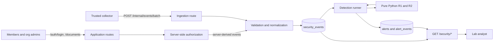

# Security Monitoring and Investigation Platform

A portfolio-scale security monitoring lab built around a fictional document-sharing
application. The project is designed to build practical skills in structured event
handling, detection engineering, Python, SQL, APIs, and security investigation.

> **Status:** Days 1–9 are complete. A small document application with two fictional
> organizations authenticates users and enforces tenant and ownership rules on the
> server. Its login and authorization decisions become trusted security events, stored in
> PostgreSQL alongside collector-ingested events. Two deterministic detections run over
> those events: failed logins followed by success (R1), and repeated denied document
> access (R2). Their results are stored as deduplicated alerts linked to raw evidence and
> exposed only to the lab analyst. The React investigation UI remains planned.

## Current capabilities

- A versioned security-event contract with event-specific validation
- Deterministic JSONL parsing, normalization, replay handling, and error reporting
- Local authentication: Argon2id password hashes and opaque, expiring, revocable
  database-backed sessions
- Two organizations with member, organization-admin, and lab-analyst roles, plus document
  create/read/update with server-side ownership and tenant isolation
- Server-generated `login_failed`, `login_succeeded`, `access_denied`, `document_created`,
  and `document_updated` events; successful changes commit with their audit event
- R1: five failed logins followed by a success within ten minutes
- R2: five distinct denied documents within five minutes, grouped into one episode with a
  15-minute inactivity cooldown
- PostgreSQL storage with constraints, foreign keys, and SQL migrations
- Trusted batch ingestion that stores replays once and rejects conflicting event IDs
- Replay-safe alert storage: rerunning either detector never duplicates an alert
- Alert-to-event evidence links and a recorded history of detector runs
- Three separate trust domains: application sessions, lab-analyst sessions, and a
  collector credential
- Behavioral, persistence, API, and authorization tests against real PostgreSQL,
  including cross-user, cross-organization, admin-scope, and analyst-only cases

Walkthroughs of the code and data flow:

- [Days 1–4: parsing and the R1 detection](docs/DAYS_1_4.md)
- [Days 5–6: PostgreSQL, persistence, and APIs](docs/DAYS_5_6.md)
- [Days 7–9: authentication, documents, application events, and R2](docs/DAYS_7_9.md)

## Architecture



PostgreSQL stores facts; the detector decides whether those facts are suspicious.
Detection functions remain independent of HTTP and database code, so the same rule runs
from the file-based CLI and the database-backed runner.

## Core stack

- Python for event processing and detection logic
- PostgreSQL (Docker Compose) and `psycopg` with parameterized SQL
- FastAPI for the document application, trusted ingestion, and investigation reads
- `pwdlib[argon2]` for password hashing; opaque database-backed sessions
- pytest for behavioral tests
- React and TypeScript for the planned document and investigation interfaces

The local project remains runnable without Splunk or AWS.

## Run it

Python 3.10 or newer and Docker are required.

```bash
python3 -m venv .venv
source .venv/bin/activate
python -m pip install -e '.[dev]'

cp .env.example .env    # then set a database password and generate COLLECTOR_TOKEN
docker compose up -d --wait
python -m scripts.migrate
python -m scripts.migrate --database-url-env TEST_DATABASE_URL
python -m scripts.seed  # fictional orgs, users, documents; prompts for one lab password

python -m pytest
```

Demonstrate the pipeline (API in one terminal, commands in another):

```bash
uvicorn backend.api:create_app --factory

python -m scripts.replay_events fixtures/days_1_2.jsonl   # collector path
python -m scripts.run_detection                          # runs R1 and R2
python -m scripts.run_detection   # second run: nothing created
```

The [Days 7–9 walkthrough](docs/DAYS_7_9.md) shows how to log in as seeded users,
trigger R1 and R2 through the real application routes, and follow each alert to its raw
evidence as the lab analyst.

The file-only tools from Days 1–4 still work without a database:

```bash
python -m scripts.parse_events fixtures/days_1_2.jsonl
python -m scripts.detect_r1 fixtures/days_1_2.jsonl
```

To wipe local data and start over: `docker compose down -v`, then repeat the Compose,
migration, and seed steps.

## What is next

Days 10–11 add a minimal React interface: login, document list/detail, and an analyst
alert list/detail that follows alerts to their supporting events. Authorization continues
to be enforced by the API.

See [Technical specification](docs/TECHNICAL.md) for the data contract, security model,
and rule specifications. See [Project roadmap](security_project_roadmap.txt) for the
planned milestones and release scope.

## Scope

This is a controlled portfolio lab, not a production SIEM or professional SOC
experience. Its threshold detections identify activity worth investigating; they do not
prove account compromise or data exfiltration. Fixtures contain only fictional data and
must never include credentials, tokens, cookies, or document contents.
