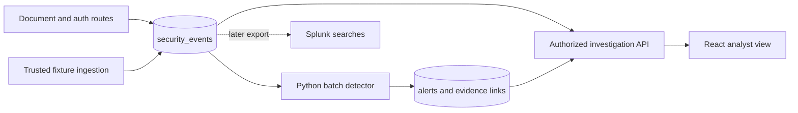

# Security Monitoring and Investigation Platform

A portfolio-scale document-sharing application that produces structured security events,
detects suspicious behavior with Python, and exposes evidence for analyst investigation.
The project is designed to build practical security analysis, detection engineering,
Python, SQL, and API skills—not to imitate a production SIEM.

> **Status:** Days 1–2 are implemented: JSONL fixtures, event validation, deterministic
> parsing, rejection reporting, and parser tests. Detections and the application remain
> planned until implemented and verified.

## Core stack

- React and TypeScript for the document and investigation interfaces
- Python and FastAPI for application APIs, event processing, and detections
- PostgreSQL for application data, security events, alerts, and case notes
- pytest for parser, rule, API, and authorization tests
- Docker Compose for a repeatable local environment
- Splunk/SPL and AWS S3, IAM, and CloudTrail as later extensions

The local project must remain runnable without Splunk or AWS.

## Architecture



Application routes derive actor identity, outcome, and source details on the server. The
detector evaluates structured events and creates deduplicated, evidence-linked alerts.
Only the lab analyst can access global security events and alerts.

See [docs/TECHNICAL.md](docs/TECHNICAL.md) for the data contract, trust boundaries,
detection specifications, and engineering rules.

## Planned repository layout

```text
.
├── backend/             # API, models, authorization, and event ingestion
├── detections/          # Pure rule logic and configuration
├── docs/                # Technical specification, threat model, and investigations
├── fixtures/            # Synthetic events and independently specified results
├── frontend/            # Document application and analyst views
├── practice/            # Focused learning exercises
├── scripts/             # Seed, replay, collector, and export utilities
├── splunk/              # SPL searches and narrow setup notes
├── tests/               # Parser, detection, API, and authorization tests
├── .github/workflows/   # Automated tests
├── .env.example
├── compose.yaml
└── README.md
```

## Current setup and parser demo

Python 3.10 or newer is required.

```bash
python3 -m venv .venv
source .venv/bin/activate
python -m pip install -e '.[dev]'
python -m scripts.parse_events fixtures/days_1_2.jsonl
python -m pytest
```

Use `--strict` when rejected records should produce exit status 2:

```bash
python -m scripts.parse_events fixtures/days_1_2.jsonl --strict
```

The parser validates event-specific required fields, normalizes timestamps to UTC,
canonicalizes attempted accounts and IP addresses, rejects duplicate event IDs within a
batch, and sorts valid events by `occurred_at` then `event_id`. A malformed line is
reported with its line number and reason while later valid records still process.

`fixtures/expected/days_1_2.json` contains the independently written counts, event order,
rejection expectations, and hand-checked R1 scenario for the next milestone. Duplicate
handling is currently batch-local; database uniqueness and replay-safe alerting belong to
later milestones.

The completed v0.1 demo will:

1. Seed fictional users in two organizations.
2. Replay benign, suspicious, malformed, and duplicate events.
3. Run two time-window detections.
4. Open an alert and follow it to the exact supporting events.
5. demonstrate that members and organization administrators cannot read global security
   records, including through direct API requests.

No live credentials, personal data, access tokens, session cookies, or document contents
belong in fixtures or logs.

## Release scope

### v0.1 — core local system

- Local document application with member, organization administrator, and lab analyst roles
- Server-side authorization across two organizations
- Structured event ingestion and PostgreSQL persistence
- Failed-logins-followed-by-success detection
- Repeated denied document access detection
- Deduplicated alerts with supporting event references
- Minimal investigation interface
- Meaningful parser, detection, API, and authorization tests
- One evidence-based investigation

### v1.0 — focused extensions

- Privilege-change-followed-by-download and high-download-volume detections
- Protected, cursor-paginated API collector with bounded retries and checkpointing
- Splunk searches compared with Python results on the same fixtures
- Alert status, notes, dispositions, and analyst action history
- CI for core behavioral tests
- Private S3 attachments and one narrowly scoped CloudTrail investigation
- Three concise investigations and a completed threat model

Kafka, Kubernetes, Redis, microservices, machine learning, OCSF, threat-intelligence
enrichment, Sysmon, multiple SIEMs, and production-scale streaming are intentionally out
of scope.

## v0.1 readiness

The project is ready to list as v0.1 only when:

- [ ] A fresh checkout runs locally from documented setup and reset instructions.
- [ ] Both detections produce deterministic, evidence-backed alerts.
- [ ] Replaying the same events creates no duplicate events or alerts.
- [ ] Direct API tests enforce user, organization, and analyst boundaries.
- [ ] Benign, suspicious, malformed, shuffled, boundary, and duplicate cases are tested.
- [ ] An alert can be followed to its raw supporting events.
- [ ] One concise investigation and a two-to-three-minute demo exist.
- [ ] Known limitations and any measured results are stated accurately.

## Scope and claims

This is a controlled portfolio lab, not professional SOC experience, a production SIEM,
or evidence of preventing breaches. Threshold detections identify behavior worth
investigating; they do not prove credential compromise, privilege escalation, or data
exfiltration. Resume statements will describe only completed, reproducible capabilities.
