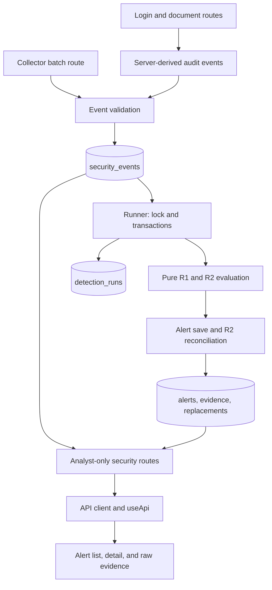

# Code map and study walkthrough

Readability review recorded October 2, 2026, after hardening Section 2 and before
Section 3. The main walkthrough records that implementation and the selective
cleanup. The [timeline](../MVP_Completion_Timeline.md),
[roadmap](../MVP_Hardening_Roadmap.md), Days 1–14 walkthroughs, and hardening
reports remain the record of how each feature was introduced.

**Section 3 update:** incremental R1 has since been added. Read the
[processing policy, extended code map, and checkpoint walkthrough](hardening_section3.md)
after this guide. The historical review and its verification results below are
preserved; the new report explains SQL filtering, chunks, snapshot visibility,
the deque optimization, and their tests.

## Code map

- **Event contract:** [models.py](../security_events/models.py) defines
  `SecurityEvent` and source-content equality; [validation.py](../security_events/validation.py)
  validates fields, event-specific requirements, timestamps, and metadata.
  [jsonl.py](../security_events/jsonl.py) reads files, reports rejected lines,
  resolves equivalent replays, and orders events.
- **Application entry and request contracts:** [api.py](../backend/api.py)
  assembles the routes. [config.py](../backend/config.py) reads settings, and
  [schemas.py](../backend/schemas.py) defines accepted bodies and response shapes.
- **Authentication and authorization:** [auth.py](../backend/auth.py) handles
  passwords, tokens, and request dependencies;
  [authorization.py](../backend/authorization.py) makes the document access
  decision. [Authentication routes](../backend/routes/auth.py) issue and revoke
  sessions. [Document routes](../backend/routes/documents.py) apply access
  decisions and record their outcomes through [audit.py](../backend/audit.py).
- **Collector and investigation routes:** [ingestion.py](../backend/routes/ingestion.py)
  validates collector batches and assigns collection time.
  [security.py](../backend/routes/security.py) exposes analyst-only event,
  alert, evidence, and replacement-history reads.
- **Database access:** [db.py](../backend/db.py) creates connections and applies
  [ordered SQL migrations](../backend/migrations). The
  [repositories](../backend/repositories) contain parameterized SQL for events,
  users/sessions, documents, alerts/evidence/replacements, and detection runs.
  The caller normally owns the transaction.
- **Detection:** [common.py](../detections/common.py) normalizes duration identity
  and deduplicates/sorts input. [R1](../detections/failed_login_success.py) and
  [R2](../detections/denied_document_access.py) are pure functions.
  [detection_runner.py](../backend/detection_runner.py) owns execution, locks,
  transaction boundaries, progress, and recovery. The
  [alert repository](../backend/repositories/alerts.py) converts rule results to
  database records and reconciles R2 history.
- **Commands:** [scripts](../scripts) contains file parsing and R1 detection,
  database migration and seeding, HTTP fixture replay, suspicious/benign
  application scenarios, telemetry reset, and database detection. In
  [run_detection.py](../scripts/run_detection.py), each selected rule gets its
  own connection and report; a failure in one does not erase another's result.
- **Frontend entry and session:** [main.tsx](../frontend/src/main.tsx) installs
  the router and auth provider; [App.tsx](../frontend/src/App.tsx) maps routes.
  [AuthContext.tsx](../frontend/src/auth/AuthContext.tsx) restores and clears
  sessions. [client.ts](../frontend/src/api/client.ts) sends requests and converts
  HTTP errors. [useApi.ts](../frontend/src/hooks/useApi.ts) tracks loading/error/data
  and expires a session on 401.
- **Frontend views:** [pages](../frontend/src/pages) compose document and alert
  screens; [components](../frontend/src/components) render filters, tables,
  navigation, and notices. [format.ts](../frontend/src/format.ts) formats values,
  [types](../frontend/src/types) describes API data, and
  [styles.css](../frontend/src/styles.css) defines presentation.
- **Evidence and checks:** [fixtures](../fixtures) and its
  [expected results](../fixtures/expected) provide independent examples.
  [Backend tests](../tests) cover parsing, rules, persistence, recovery, APIs,
  authorization, and scenarios. [App.test.tsx](../frontend/src/App.test.tsx)
  exercises the UI through mocked HTTP responses. The
  [CI workflow](../.github/workflows/tests.yml) runs both suites, typecheck, and
  build. [Compose](../compose.yaml) supplies local PostgreSQL.



## Study order

Start with the event model and one fixture record. Follow the R1 example below,
then study the database runner and its failure path. Continue with authentication
and document authorization to understand how real application activity becomes
events. Finally, follow R2 reconciliation and the frontend investigation flow.

Each walkthrough names a test that makes the behavior observable. These commands
assume the repository virtual environment is installed. Database tests use
`TEST_DATABASE_URL`, require a database name ending in `_test`, apply migrations,
and truncate test data between tests. Use the dedicated test database described
in the [setup instructions](../README.md#set-up-from-a-fresh-checkout).

### 1. Follow one R1 alert

1. Open [days_1_2.jsonl](../fixtures/days_1_2.jsonl) alongside its
   [expected result](../fixtures/expected/days_1_2.json). `parse_jsonl` returns 18
   events: one malformed line is rejected and one equivalent replay is collapsed.
2. In `detect_failed_logins_followed_by_success`, events are ordered by event time
   and ID, then grouped by organization and attempted account. For Alice's
   `evt-009` success at 13:00 UTC, `_failures_before` accepts failures in
   `[12:50, 13:00)`. The start is included; failures at the success time are excluded.
3. The qualifying failures are `evt-004` through `evt-008`. `_build_alert` records
   those five failures and the success as evidence. The alert key includes rule
   version, configuration, and success event ID. Another qualifying success gets
   its own alert, even if it uses some of the same failures.
4. The database runner loads stored events and calls the same pure rule.
   `failed_login_alert_record` adds evidence roles. `save_alert` inserts an alert
   and its evidence, or compares a stored alert's severity, reason, and evidence
   to classify a rerun. An update preserves analyst status.
5. Follow `test_ingest_detect_and_follow_alert_to_raw_evidence` in
   [test_api.py](../tests/test_api.py): replay, rerun detection, authenticate as an
   analyst, and read the evidence through the API.

```bash
./.venv/bin/python -m scripts.detect_r1 fixtures/days_1_2.jsonl
./.venv/bin/python -m pytest tests/test_failed_login_success.py tests/test_persistence.py
```

Study question: why does the success event appear in evidence although the failure
window excludes its timestamp? It anchors the alert; only the failure count uses
the half-open window.

### 2. Follow a failed run and recovery

Read `_run_detection` and `_detect_and_save` with
[test_detection_recovery.py](../tests/test_detection_recovery.py).

1. Acquire the PostgreSQL **session advisory lock**. Its transaction ends, but the
   lock stays with that connection. A competing runner receives `RunnerBusy`
   before creating a run or marking another run abandoned.
2. In a separate transaction, mark surviving `running` rows as `abandoned` and
   insert this run's `running` row. Commit this before doing detection work.
3. In the work transaction, acquire the `alerts` table lock, load events, evaluate
   the rule, persist all alert changes, and call `finish_run`. The alerts,
   evidence, R2 replacement links, and successful run record commit together.
4. If work raises an exception, that transaction rolls back. Python's progress
   object still holds the scan metrics. `_record_failed_run` commits a separate
   failure record with those metrics and a safe error category.
5. The outer `finally` invokes `_release_runner_lock`. If the connection was lost,
   the failure record may remain `running`; the next worker recovers it only after
   acquiring the advisory lock. PostgreSQL releases session locks when the session
   ends. The table lock ends with the work transaction.

There are two application-data commits on success: registration, then results.
On a detected failure, results roll back and the failure record commits separately.
The small lock acquisition/release transactions do not persist detection results.
Keep the runner connection free of an existing transaction when calling it.

```bash
./.venv/bin/python -m pytest tests/test_detection_recovery.py
```

Study question: why not raise the original exception to the CLI? The runner exposes
a safe category and suppresses the displayed exception chain; recovery tests check
that injected passwords and tokens do not appear in reports or logs.

### 3. Follow authentication and a document decision

The login route canonicalizes the login, looks up the user, and verifies the
password. An unknown account still performs a dummy password verification. The
explicit `password_matches` result chooses the success or failure branch.

On failure, the route records `login_failed` and exits the database connection
normally before raising the generic 401. Raising inside that transaction would
roll back the telemetry. Known-account and unknown-account failures have the same
HTTP response but different internal audit reasons. On success, the session and
`login_succeeded` event commit together. The client receives the raw random token;
the database stores its digest.

For later requests, `require_user` looks up an unexpired, unrevoked session.
`require_analyst` protects every security route. `require_organization_user` and
`decide_document_access` protect documents: owners and organization admins have
access within their organization, and the analyst has no implicit document access.
Cross-organization and missing documents share a 404 response. Denial events carry
the caller's organization and requested document ID.

Read the wrong-password, revoked/expired session, cross-organization, and audit
rollback cases in [test_application.py](../tests/test_application.py), then the
credential matrix in [test_api.py](../tests/test_api.py).

### 4. Follow an R2 late arrival

Read [r2_late_arrival.jsonl](../fixtures/r2_late_arrival.jsonl), its
[before/after expectation](../fixtures/expected/r2_late_arrival.json), and
`test_late_denial_replaces_crossing_and_preserves_history` in
[test_r2_persistence.py](../tests/test_r2_persistence.py).

1. With only `denial-0` through `denial-4`, the fifth distinct document opens an
   episode at `denial-4`. R2's opening window includes both endpoints.
2. `denial-late` arrives later but occurred at 11:59:45 UTC, before the other five
   events. Full-history evaluation now reaches five distinct documents at
   `denial-3`; `denial-4` extends that episode. The current result has a new key
   and six evidence events.
3. `_load_active_episodes` snapshots existing keys, analyst statuses, and evidence
   for the exact rule version, threshold, window, and cooldown configuration.
   This happens before `save_alert` can replace any current evidence links.
4. Reconciliation saves current results and indexes their evidence by organization,
   actor, and event ID. `_find_replacement_keys` uses shared evidence to match an
   obsolete result to its successor or successors.
5. `_supersede_alert` changes the old detection state and writes replacement links.
   The old alert keeps its evidence and analyst status. A closed old alert marks
   its replacement `needs_review`; it does not close the replacement.
6. A missing successor raises an error. A failed replacement write also rolls back
   the whole work transaction. The test that injects a database trigger failure
   verifies that the old result remains active and a later retry succeeds.

The five-minute window opens an episode. After opening, each denial within fifteen
minutes of the previous evidence event extends it, including a denial exactly on
the cooldown boundary. An episode can therefore last longer than five minutes.
Repeated requests count as evidence, while the threshold counts distinct documents.

```bash
./.venv/bin/python -m pytest tests/test_denied_document_access.py tests/test_r2_persistence.py
```

Study question: why keep detection state separate from analyst status? A correction
to a detection's identity must preserve the case decision attached to the old result.

### 5. Follow the analyst's screen

`AuthProvider` restores the stored session with `/auth/me`. `Layout` chooses useful
navigation, while the API enforces authorization. A 401 clears the frontend session;
a 403 displays an error without logging the user out.

`AlertsPage` reads rule, status, entity, and organization filters from the URL.
The history flag controls whether `listAlerts` requests superseded results from the
server; the other filters are applied locally by `filterAlerts`. Clearing filters
retains the history flag. Toggling history retains the filters.

`AlertDetailPage` requests one alert and displays its reason, configuration,
replacement links, and evidence. `EventTable` uses the server's chronological
evidence order and expands raw JSON on demand. Inspect the matching user flows in
[App.test.tsx](../frontend/src/App.test.tsx).

```bash
cd frontend
npm test
npm run typecheck
npm run build
```

## Syntax worth recognizing

- **`with connect(...)` and `with conn.transaction()`:** these are context managers.
  The connection context commits on normal exit, rolls back on an exception, and
  closes the connection. A transaction context commits or rolls back its block
  without closing the connection. With an already-open transaction, a nested
  transaction context may use a savepoint; this is why the runner requires an idle
  connection rather than relying on an outer transaction.
- **`try` / `except` / `finally`:** `except` handles matching errors; `finally`
  attempts cleanup on success or exception. Abrupt process termination can bypass
  Python cleanup, which is why persisted run state and database lock ownership
  also matter. `raise ... from None` suppresses the displayed exception chain.
- **`@dataclass(frozen=True)` and `replace`:** the decorator generates data-object
  methods and prevents field reassignment. It does not recursively freeze nested
  objects. `replace(summary, duration_ms=...)` makes a new summary; it leaves the
  original frozen object unchanged. Mutable `DetectionRunProgress` intentionally
  retains observed metrics after a database rollback.
- **Comprehensions and unpacking:** `[row["run_id"] for row in rows]` clearly maps
  rows to IDs. `**row` passes dictionary entries as keyword arguments; `*events`
  expands sequence elements. A standalone `*` in a parameter list makes following
  arguments keyword-only. These forms remain where they express simple operations.
- **Sets and `defaultdict(set)`:** a set keeps unique values; `frozenset` is its
  immutable counterpart. Evidence stores `(event_id, role)` pairs so comparison
  ignores ordering. `defaultdict(set)` creates a set when a missing key is indexed;
  `.get(...)` only looks up a key. Reconciliation uses an explicit tuple of tenant,
  actor, and event ID to keep matches scoped correctly.
- **Type hints and dependencies:** `str | None` allows either a string or no value.
  `Callable` describes a function signature. The runner's nested detector functions
  capture the chosen configuration. FastAPI's `Depends(...)` declares a dependency
  that the framework resolves before executing the route. `Annotated[..., Query(...)]`
  attaches request-validation metadata to a type.
- **SQL parameters:** `%s` and `%(name)s` are driver placeholders; values are supplied
  separately. The f-strings in repository queries insert fixed SQL fragments such as
  column lists. SQL `ON CONFLICT DO NOTHING` makes an existing event or replacement
  link safe to replay; conflict-content checks for ingested events happen separately.
- **TypeScript `as`, generics, and narrowing:** `as T` tells the compiler how to view
  a value; it does not validate a server response. `request<T>` and `Promise<T>`
  describe the expected result type. `as const` preserves literal types, and a type
  predicate such as `value is string` lets a filter narrow nullable values. The alert
  URL filters now use an explicit typed object instead of `as unknown as ...`.
- **`??`, `?.`, and JSX:** `??` supplies a fallback only for `null`/`undefined`;
  `?.` safely accesses a possibly missing value. `condition && <Component />` is a
  conventional conditional render. Side-effect callbacks now use explicit `if`
  statements instead of short-circuiting state updates.
- **React effects:** an effect's returned function is cleanup. The `active` flag in
  session restoration and `useApi` prevents outdated callbacks from updating state;
  it does not cancel the HTTP request. `useApi` uses its resource key to trigger a
  reload when the resource changes. `useCallback` and `useMemo` keep function/value
  identities stable according to their dependencies.
- **pytest fixtures and `monkeypatch`:** named fixtures supply shared setup, including
  the test database. `parametrize` runs a test for multiple cases. `monkeypatch`
  temporarily replaces a function or environment value; recovery tests use it to
  inject failures at meaningful write/commit boundaries. The SQL-trigger test uses
  `finally` to remove its injected failure after the check.

## Readability review record

The review covered the first-party backend, event package, detections, scripts,
frontend, tests, migrations, fixtures, and build/test configuration. Generated
dependencies and build output were outside the review.

Changes were limited to concrete reading difficulties:

- The runner's nested recovery and lock-release code obscured its main sequence.
  Dedicated helpers now expose those responsibilities, and the docstring distinguishes
  the session lock from transaction lifetime. Saving an alert and incrementing its
  outcome counter are separate statements.
- R2 reconciliation mixed loading, evidence matching, and historical writes. Named
  helpers now separate those steps. The membership-only dictionary is a set of keys,
  and prior episodes are constructed with named fields. SQL write order is retained.
- Login reused the user variable as a failure marker. An explicit password result now
  controls the outcome; a short comment explains why 401 must follow the audit commit.
- Frontend filter predicates, URL filter construction, callback side effects, and a
  nested error-heading ternary now use explicit control flow. The added UI test covers
  URL restoration and preserving filters/history across changes.
- R2 tests now name before/after expectations, look up the historical alert once, and
  expose database reads outside a nested comprehension. The application test helper
  handles its optional event filter explicitly. R1 test timestamps no longer subtract
  a negative duration, and a single-case parametrization was removed.

Areas left unchanged after review:

- **Pure detections and event processing:** rule grouping, boundary checks, episode
  state, and alert construction already have distinct functions. Parser stages and
  validation helpers describe their duties directly. Their simple comprehensions,
  duration arithmetic, and deterministic ordering remain useful and readable.
- **Authorization, audit, and API contracts:** the small document policy function
  makes tenant checks precede ownership checks. Route code shows where authorization
  and audit writes happen; comments explain information-disclosure decisions.
  Request/response schemas and field validators already state the accepted contract.
- **Simple persistence and configuration:** user, document, event, and run repositories
  keep SQL close to its parameters. Their transaction ownership is established by
  their callers. Connection setup, settings, migrations, and constraints are explicit.
  The alert upsert's existing comparison and analyst-field preservation were retained.
- **Commands:** parsing, seeding, migration, replay, scenario generation, and reset
  helpers already have clear entry points and exit behavior. The detection CLI's
  selection and per-rule reporting sequence is short enough to follow directly.
  Similar argument declarations did not justify a new CLI abstraction.
- **Frontend presentation:** API wrappers, types, route composition, document views,
  alert/evidence rendering, formatting, and CSS each have narrow duties. Existing
  components already separate reusable presentation; additional wrappers would add
  navigation overhead without clarifying behavior.
- **Tests and fixtures:** most tests describe one behavioral scenario with explicit
  expected values. Recovery fault injection and boundary cases remain intact.
  Expected fixture files stay independent of detector output. Existing historical
  documents and migration files were preserved as implementation records.
- **Build and test setup:** Python and npm manifests, TypeScript/Vite configuration,
  Compose, and CI directly declare dependencies and checks. No dependency or tooling
  change was needed for this review.

At the time of this cleanup, Section 3 remained future work: the database runner loaded full event history,
and no checkpoint, query optimization, indexing change, or new processing policy
was introduced by this cleanup.

## Verification

Relevant tests were run after each code change: runner/reconciliation persistence
and recovery, authentication/API behavior, edited tests, parser/detector behavior,
and frontend tests with TypeScript checking.

Final local results on October 2, 2026:

- `./.venv/bin/python -m pytest -rN`: 151 passed, no skips, against PostgreSQL.
- `npm test` in `frontend`: 9 passed.
- `npm run typecheck` and `npm run build`: passed.
- `git diff --check`: passed. Local links in this guide and the README resolve.

The diff review confirmed that the cleanup changes no API or database schema,
rule semantics, authorization policy, transaction boundaries, or recovery behavior.
