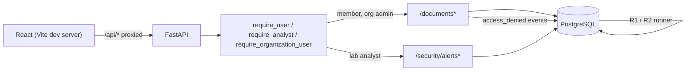

# Days 10–11 Implementation Walkthrough

Days 1–9 built the whole pipeline: real users act, the server makes the authorization
decision, that decision becomes a trusted event, and R1/R2 turn events into
evidence-linked alerts. Days 10–11 add the human end of it: a small React client that
lets a normal user work with documents and lets the lab analyst follow an alert back to
the raw events that caused it.

```text
alert -> alert list -> alert detail -> reason + threshold check -> ordered raw evidence
```

The frontend adds no API routes and holds no security authority. Every decision it
displays was made by FastAPI.



## Code map

| Path | Responsibility |
| --- | --- |
| `frontend/src/api/client.ts` | The only place that calls `fetch`: bearer header, JSON parsing, `ApiError(status, detail)` |
| `frontend/src/api/{auth,documents,security}.ts` | One typed function per backend route the UI uses |
| `frontend/src/types/` | TypeScript mirrors of `backend/schemas.py` and `SecurityEvent` |
| `frontend/src/auth/AuthContext.tsx` | Token in `sessionStorage`, profile from the server, sign in/out, expiry |
| `frontend/src/hooks/useApi.ts` | Loading/error state for a request; any `401` ends the session |
| `frontend/src/components/Layout.tsx` | Requires a session; role-aware navigation (usability only) |
| `frontend/src/pages/` | Login, document list/detail, alert list/detail |
| `frontend/src/components/AlertFilters.tsx` | Client-side rule, status, organization, actor/account filters |
| `frontend/src/components/EventTable.tsx` | Evidence rows with metadata and the full raw event |
| `frontend/src/App.test.tsx` | Behavioral tests with a mocked API |

## Authentication in the browser

```text
POST /auth/login {login, password}
  -> 200 {access_token, expires_at, user}
  -> token saved in sessionStorage; profile kept in React state
every later request
  -> Authorization: Bearer <token>
page reload
  -> GET /auth/me with the stored token; the server says who this token belongs to
```

Only the token is stored. On reload the profile, including the role, is fetched again from
`/auth/me` rather than trusted from browser storage. Editing React state in DevTools to
claim `lab_analyst` might reveal a nav link, but `GET /security/alerts` still resolves the
real session in PostgreSQL and returns `403`.

`sessionStorage` is tab-scoped and cleared when the tab closes. Like any script-readable
storage it is exposed to XSS; the UI never renders HTML from the API
(React escapes all text), but an `HttpOnly` cookie with CSRF protection would be the
stronger production choice.

## 401 versus 403 in the UI

| API answer | Meaning | UI behavior |
| --- | --- | --- |
| `401` | Missing, invalid, expired, or revoked credential | Discard the token, return to login with "Your session has expired" |
| `403` | Valid session, wrong role or ownership | Stay signed in; show "Not authorized" with the server's reason |
| `404` | Not found, including another tenant's document | Show "Not found"; the UI cannot tell which case it was either |
| other / network | Server or connectivity failure | Show the error |

Treating a `403` as a logout would be wrong: the session is still valid, the account just
may not do this.

The route guard in `Layout` only checks that someone is signed in. It deliberately does not
block a member from typing `/alerts`: the page calls the API and renders the server's
`403 lab analyst role required`. The navigation shows Documents to members and admins and
Alerts to the analyst, purely so each role sees what it can use.

## The pages

**Documents** (`/documents`, `/documents/:id`): the list is whatever the server returns
for this session (members see their own, admins their organization). Detail is read-only.
Opening someone else's document in the same organization shows `403`; another tenant's or
a nonexistent ID shows the same `404`. Each denial is recorded by the server as an
`access_denied` event, which is what feeds R2.

**Alerts** (`/alerts`): rule, actor/account, organization, window, `match_count /
threshold`, severity, status, and reason. Filters are applied in the browser to the full
list and kept in the URL query string, so a filtered view can be bookmarked. That is fine
for a lab with a handful of alerts; with many alerts filtering must move into SQL with
pagination, which belongs to the later API-client work.

**Alert detail** (`/alerts/:alertKey`) is the core of the milestone:

- The rule's own `reason`.
- A threshold check phrased per rule, for example `Distinct denied documents: 5
  (threshold 5, window 5 minutes)` or `Failed logins: 5 (threshold 5, window 10 minutes)`.
- Window start/end, R2 cooldown and suppression time, source IPs, requested resource IDs,
  session, and the deterministic alert key.
- Every evidence event, oldest first, with its evidence role, type, outcome, actor or
  account, resource, source IP, and metadata (`action=read`, `reason=not_owner`), with
  millisecond timestamps so rapid requests still read in order. The **JSON** button on a
  row expands the complete stored event, including its event ID and request ID, beneath
  it.

## Following an alert to its evidence

```text
analyst clicks an R2 row
  -> /alerts/<encoded alert_key>
  -> GET /security/alerts/{alert_key}   (Authorization: Bearer <analyst token>)
  -> require_analyst: session -> user -> role == lab_analyst
  -> alerts JOIN alert_events JOIN security_events, ordered by occurred_at, event_id
  -> JSON -> reason, threshold check, evidence table
```

For R2 the analyst can count distinct `resource_id` values in the evidence table and
confirm the threshold, see which were `not_owner` versus `cross_organization`/`not_found`,
and decide whether this looks like enumeration or a benign stale link. For R1 the table
shows the `failed_login` rows followed by the `successful_login` row; counting the
failures inside the window reproduces the rule. The alert says a threshold was crossed,
not that the user is an attacker.

## Run it

Backend setup is unchanged ([Days 7–9](DAYS_7_9.md#run-it)). Then, in three terminals:

```bash
uvicorn backend.api:create_app --factory          # API on 127.0.0.1:8000

cd frontend && npm install && npm run dev          # UI on http://127.0.0.1:5173

python -m scripts.run_detection                    # after generating activity
```

The Vite dev server proxies `/api/*` to `http://127.0.0.1:8000` (override with the
`API_URL` environment variable), so the browser talks to one origin and the backend needs
no CORS configuration. Serving the production build (`npm run build`) behind a real
reverse proxy is out of scope for v0.1.

Demo path:

1. Sign in as `bob@alpha.example.test`. Open `doc-alpha-004` (allowed). Enter
   `/documents/doc-alpha-001`, `-002`, `-003`, `-005` and `/documents/doc-beta-001` in the
   address bar: four `403`s and one `404`. Enter `/alerts`: `403`.
2. Sign out and fail five logins for `alice@alpha.example.test`, then sign in correctly.
3. Run `python -m scripts.run_detection`.
4. Sign in as `analyst@lab.example.test`, filter to R2, open Bob's alert, and read the
   evidence. Open the R1 alert for Alice the same way. Enter `/documents`: `403`.

Behind the dev proxy the API sees the proxy's loopback connection, so application events
created through the UI record `source_ip = 127.0.0.1`.

## Authorization without the UI

The UI changes nothing on the server, and the existing tests prove the boundary through
direct requests: `tests/test_api.py` checks every `/security/*` route with no token, an
unknown token, the collector token (`401`) and member and admin sessions (`403`), and
`tests/test_application.py` checks that the analyst gets `403` from `/documents`. The same
can be shown by hand, bypassing React entirely:

```bash
curl -s -w " %{http_code}\n" -H "Authorization: Bearer $BOB" $API/security/alerts
# {"detail":"lab analyst role required"} 403
curl -s -w " %{http_code}\n" -H "Authorization: Bearer $AN" $API/documents
# {"detail":"organization membership required"} 403
```

## Tests

```bash
cd frontend
npm test             # vitest + Testing Library, API mocked at fetch
npm run typecheck
npm run build
```

`src/App.test.tsx` covers: sign-in stores the token and sends it as a bearer header; bad
credentials show the server's generic error and store nothing; a `401` discards the token
and returns to login; a `403` shows "Not authorized" and keeps the session; another
tenant's document shows the uniform `404`; alert filters by rule and by case-insensitive
actor/account; and alert detail shows the reason, the threshold check, and the evidence in
time order with its denial reasons.

These tests prove the client handles each response correctly. They are not evidence of
authorization; that lives in the Python tests against real PostgreSQL.

## Limitations

- Development server only; no production hosting, HTTPS, or content-security policy.
- The token is in `sessionStorage` (script-readable) rather than an `HttpOnly` cookie.
- Alerts are fetched in full and filtered in the browser; no pagination.
- Documents are read-only in the UI; create and update exist only in the API.
- No alert status changes, notes, or dispositions yet; status is displayed only.
- No general event search screen; the analyst sees the events linked to each alert.
- Evidence is only as good as the stored events: denials whose audit write failed, or
  activity outside the application, will not appear.
