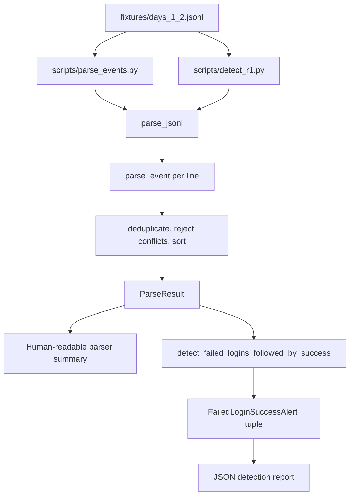

# Days 1–4 Implementation Walkthrough

This document explains the code currently implemented in the project. Days 1–2 establish
the security-event contract and JSONL parser. Days 3–4 add the first detection rule:
failed logins followed by a successful login.

This layer is intentionally batch-based and independent of databases and HTTP. Days 5–6
wrap it with PostgreSQL and FastAPI without changing its behavior; see the
[Days 5–6 walkthrough](DAYS_5_6.md).

## End-to-end process



There are two command-line paths:

1. `scripts.parse_events` reads the fixture and reports its quality.
2. `scripts.detect_r1` uses the same parser, passes only accepted events to R1, and
   returns alerts with their evidence.

This separation is important. The parser is the validation and quarantine boundary. The
detector can assume it receives typed `SecurityEvent` objects rather than arbitrary JSON.

## Days 1–2: event parsing and validation

The parser lives in the [`security_events`](../security_events) package, which Days 5–6
split out of the original `scripts/event_parser.py` without changing behavior:

- [`models.py`](../security_events/models.py): `SecurityEvent`, source-equivalence, and UTC
  formatting
- [`validation.py`](../security_events/validation.py): `parse_event` and the contract rules
- [`jsonl.py`](../security_events/jsonl.py): `parse_jsonl` and batch replay/conflict handling

### Data types

The module uses frozen dataclasses so parsed records and results are explicit and are not
accidentally modified:

- `SecurityEvent` is the normalized event passed to detection rules.
- `RejectedRecord` stores the source line number and rejection reason.
- `DuplicateRecord` identifies a replay and the line that was retained.
- `ParseResult` contains accepted events, rejected records, duplicates, and the total
  number of lines read.

`ParseResult.event_type_counts` derives a sorted event-type summary from the accepted
events. `SecurityEvent.to_dict()` converts timestamps back to UTC `Z` strings so output
can be serialized to JSON.

### `parse_event`: validate one decoded JSON value

`parse_event(record)` transforms one JSON object into a `SecurityEvent`. It rejects the
record with `EventValidationError` when any requirement fails.

Validation occurs in these layers:

1. **Object and field checks.** The input must be an object, and every key must be in
   `ALLOWED_FIELDS`. Unknown fields are rejected instead of silently ignored.
2. **Controlled values.** Event type, source, outcome, role, resource type, and schema
   version must come from explicit allow lists. The only supported schema version is the
   string `"1.0"`.
3. **Event-shape checks.** `_validate_event_shape` makes required fields depend on the
   event type.
4. **Value safety checks.** Required strings are trimmed, limited to 256 characters, and
   rejected if they contain control characters.
5. **Normalization.** Timestamps are converted to UTC, attempted accounts are case-folded,
   and IP addresses are converted to canonical IPv4 or IPv6 text.
6. **Metadata checks.** Metadata must be an object no larger than 4,096 serialized bytes.
   Nested values are checked for oversized strings, control characters, and forbidden
   keys such as passwords, tokens, cookies, and document content.

The event-specific requirements are:

- `login_failed`: outcome is `failure`; organization and attempted account are required.
  Actor and session may be absent because authentication did not succeed.
- `login_succeeded`: outcome is `success`; organization, attempted account, actor, and
  session are required.
- `access_denied`: outcome is `denied`; organization, actor, session, and resource type
  are required. A document denial also requires a resource ID.
- `document_downloaded`: outcome is `success`; actor and session are required, resource
  type must be `document`, and a resource ID is required.
- `role_changed`: outcome is `success`; actor, session, target actor, previous role, and
  new role are required. Previous and new roles must differ.

Other required fields shared by every event include `event_id`, `occurred_at`,
`ingested_at`, `source`, `request_id`, and `schema_version`. Timestamps must include a
timezone; naive timestamps are rejected.

### `parse_jsonl`: process a complete batch

`parse_jsonl(path)` opens the file as bytes and processes each line independently.

For every line it:

1. Enforces the 16,384-byte line limit.
2. Decodes UTF-8.
3. Rejects blank lines.
4. Decodes JSON.
5. Calls `parse_event`.
6. Groups valid events by `event_id` for batch-level replay handling.

Decode, JSON, and validation errors are converted into `RejectedRecord` values. The loop
continues, so one malformed line does not erase valid events later in the file.

After all lines are read, records with the same event ID are classified in one of two
ways:

- **Source-equivalent replay:** every normalized field except `ingested_at` matches.
  The parser keeps the occurrence with the earliest ingestion timestamp and records the
  others as duplicates. File line number breaks a tie.
- **Conflict:** at least one source-content field differs. Every occurrence of that event
  ID is excluded and reported as rejected. This avoids making an arbitrary version
  authoritative.

Accepted events are finally sorted by `(occurred_at, event_id)`. Rejections and duplicate
reports are sorted by line number. This makes results stable even when input ordering
changes.

`events_have_same_source_content(first, second)` implements the replay comparison by
checking every `SecurityEvent` dataclass field except `ingested_at`.

### Parser CLI

[`scripts/parse_events.py`](../scripts/parse_events.py) is a small interface around
`parse_jsonl`.

```bash
python -m scripts.parse_events fixtures/days_1_2.jsonl
```

It prints lines read, accepted events, rejected records, duplicate records, event-type
counts, and line-specific details. File access failures return exit status `1`.

With `--strict`, a batch containing rejected records returns status `2` after printing
the report:

```bash
python -m scripts.parse_events fixtures/days_1_2.jsonl --strict
```

A source-equivalent replay is reported as a duplicate but does not fail strict mode.

## Days 3–4: R1 failed logins followed by success

The pure detection rule is implemented in
[`detections/failed_login_success.py`](../detections/failed_login_success.py).

### Rule configuration and output

`FailedLoginSuccessConfig` supplies two validated settings:

- `threshold`: at least `5` failures by default
- `window`: a `10`-minute lookback by default

The threshold must be at least one and the window must be positive.

Each match becomes a frozen `FailedLoginSuccessAlert`. It contains:

- Rule identity, version, and medium severity
- Organization and canonical attempted account
- Actor and session from the successful login
- Exact window boundaries and configuration
- Ordered failure event IDs and the success event ID
- All evidence event IDs
- Sorted, distinct source IPs observed across the evidence
- A human-readable reason

`FailedLoginSuccessAlert.to_dict()` converts tuples to JSON arrays and timestamps to UTC
`Z` strings.

### `detect_failed_logins_followed_by_success`

The function accepts any iterable of validated `SecurityEvent` objects and returns an
immutable tuple of alerts.

Its logic is:

1. Use `_deduplicate_and_sort` to collapse source-equivalent replays and order events by
   `(occurred_at, event_id)`.
2. Ignore events without an organization or attempted account.
3. Group login failures by `(organization_id, attempted_account)`.
4. When a successful login occurs at time `t`, calculate `t - window`.
5. Select failures for that entity in the interval `[t - window, t)`.
6. If the count meets the threshold, create one alert for that success.

The inclusive start means a failure exactly ten minutes before a success qualifies. The
exclusive end means a failure with the same timestamp as the success does not qualify.
Accounts and organizations never contribute failures to one another.

Failures remain available for later successes. Therefore, two successful logins can
produce two distinct alerts when each has enough preceding evidence.

### Detection-side replay behavior

`_deduplicate_and_sort` protects direct callers that do not use `parse_jsonl` first. It
uses the same source-equivalence definition and retains the earliest `ingested_at`.

Unlike the parser, the pure detector has no line numbers or rejection channel. If two
events share an ID but differ in source content, it raises `ValueError` instead of
silently choosing or dropping one. The normal CLI path avoids this because parser
conflicts have already been quarantined.

### Deterministic alert identity

Every alert key has this structure:

```text
R1_FAILED_LOGINS_FOLLOWED_BY_SUCCESS:1.0:threshold=5:window_us=600000000:evt-009
```

It includes:

- Rule ID and version
- Configured threshold
- Exact window duration in microseconds
- Successful login event ID

The same events and configuration always produce the same key. Different thresholds or
windows cannot accidentally share an identity. Days 5–6 can use this key for replay-safe
database upserts.

### Detection CLI

[`scripts/detect_r1.py`](../scripts/detect_r1.py) connects the parser and detector:

```bash
python -m scripts.detect_r1 fixtures/days_1_2.jsonl
```

The JSON output contains parse counts, rejection and duplicate details, alert count, and
serialized alerts. The rule can be adjusted for local experiments:

```bash
python -m scripts.detect_r1 fixtures/days_1_2.jsonl \
  --threshold 3 \
  --window-minutes 5
```

Threshold and window arguments must be positive integers. As with the parser CLI, file
access failure returns `1`, while `--strict` returns `2` only when parser rejections exist.

## Worked fixture example

[`fixtures/days_1_2.jsonl`](../fixtures/days_1_2.jsonl) exercises valid, suspicious,
malformed, and replayed activity in one batch. Its independently written expectations
are in
[`fixtures/expected/days_1_2.json`](../fixtures/expected/days_1_2.json).

The parser result is:

- 20 lines read
- 18 accepted events
- 1 rejected record: malformed JSON on line 18
- 1 duplicate record: line 19 replays `evt-009`; line 9 is retained because it has the
  earlier `ingested_at`

The hand-checked R1 sequence is:

```text
12:49:59  evt-003  failure  outside the window
12:50:00  evt-004  failure  inclusive start
12:52:00  evt-005  failure
12:54:00  evt-006  failure
12:56:00  evt-007  failure
12:59:00  evt-008  failure
13:00:00  evt-009  success  exclusive window end
```

All times are shown in UTC after normalization. `evt-003` is one second too early.
`evt-004` through `evt-008` are the five qualifying failures for canonical account
`alice@example.test` in `org-alpha`. The success `evt-009` creates one alert with those
six event IDs as evidence.

The fixture also contains failures for other accounts and organizations. They do not
contribute to Alice's alert because the rule groups on both organization and canonical
account.

## Tests define the behavioral contract

[`tests/test_event_parser.py`](../tests/test_event_parser.py) verifies:

- The fixture matches its independently specified counts and ordering
- Invalid records do not discard later valid records
- UTC, account, and IP normalization
- Invalid schema values, field combinations, metadata, and unknown fields
- Source-equivalent replay handling and earliest-ingestion retention
- Complete exclusion of conflicting IDs, including an A/B/A sequence
- Deterministic timestamp/event-ID sorting
- Parser CLI reports and exit statuses

[`tests/test_failed_login_success.py`](../tests/test_failed_login_success.py) verifies:

- Below, at, and above-threshold behavior
- Inclusive window start and exclusive success time
- Account and organization isolation
- Stable results for shuffled input and replayed events
- Missing source IP handling
- Conflict failure for direct detector callers
- Configurable thresholds and windows
- Configuration-sensitive alert identities
- One alert per qualifying success
- Parser conflict quarantine before detection
- The hand-checked fixture alert and CLI evidence output

Run the full suite with:

```bash
python -m pytest
```

Expected values are written independently rather than generated by the implementation
under test.

## Boundary for Days 5–6

This layer provides the pieces persistence builds on:

- Validated and normalized `SecurityEvent` objects
- Explicit rejected and duplicate record reporting
- Deterministic event ordering
- Deterministic alert keys
- Ordered evidence event IDs

The guarantees in this document are local to one batch. Durable, cross-request replay
protection is covered in the [Days 5–6 walkthrough](DAYS_5_6.md).
