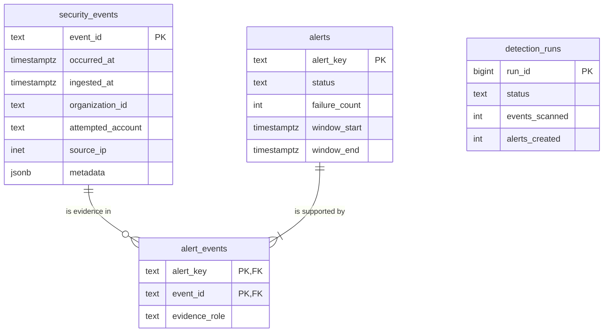

# Days 5–6 Implementation Walkthrough

> **Superseded in Days 7–9:** the static analyst token was replaced by a lab-analyst user
> session from `POST /auth/login`, and `alerts.failure_count` became the rule-neutral
> `match_count`. Current analyst requests require a session token.
> See the [Days 7–9 walkthrough](DAYS_7_9.md).

Days 5–6 turn the batch scripts into a small security pipeline:

```text
Trusted collector
      |
      v
POST /internal/events/batch   (collector token only)
      |
      v
Validate + normalize          (security_events.parse_event)
      |
      v
PostgreSQL security_events    (event_id is the primary key)
      |
      v
python -m scripts.run_detection
      |   loads events, calls the unchanged pure R1 function
      v
alerts + alert_events         (alert_key is the primary key)
      |
      v
GET /security/alerts, /security/alerts/{alert_key}, /security/events   (analyst session only)
```

The central rule: **PostgreSQL stores facts; the detector decides whether those facts are
suspicious.** R1 still has the signature `events -> alerts` and knows nothing about HTTP or
SQL, so it stays testable without a database.

## Code map

| Path | Responsibility |
| --- | --- |
| `security_events/models.py` | `SecurityEvent`, source-equivalence, UTC formatting |
| `security_events/validation.py` | `parse_event`: the single validation authority |
| `security_events/jsonl.py` | `parse_jsonl`: file batches, replays, conflicts |
| `detections/failed_login_success.py` | Pure R1 rule (unchanged behavior) |
| `backend/migrations/001_initial.sql` | Tables, constraints, indexes |
| `backend/db.py` | `connect()` and `apply_migrations()` |
| `backend/config.py` | Settings from environment variables / `.env` |
| `backend/repositories/events.py` | Insert, replay/conflict check, event reads |
| `backend/repositories/alerts.py` | Alert upsert, evidence links, alert reads, `JOIN` |
| `backend/repositories/detection_runs.py` | Run audit records |
| `backend/detection_runner.py` | Load events -> R1 -> save alerts, in transactions |
| `backend/auth.py` | Collector token, user sessions, and role dependencies |
| `backend/schemas.py` | Pydantic request and response models |
| `backend/routes/ingestion.py` | `POST /internal/events/batch` |
| `backend/routes/security.py` | `GET /security/...` analyst reads |
| `backend/api.py` | `create_app()` wiring |
| `scripts/migrate.py`, `run_detection.py`, `replay_events.py` | Command-line entry points |

The parser previously lived in `scripts/event_parser.py`, a CLI folder. It moved into its
own `security_events` package so the CLI, detector, and API all import the same contract
from a neutral place. The move was verified with the unchanged Days 1–4 test suite before
any Days 5–6 behavior was added.

## Setup and reset

```bash
cp .env.example .env
python -c "import secrets; print(secrets.token_urlsafe(32))"   # set COLLECTOR_TOKEN
# also replace the password in POSTGRES_PASSWORD, DATABASE_URL, and TEST_DATABASE_URL
# set SEED_USER_PASSWORD before running scripts.seed or scripts.generate_scenarios

docker compose up -d --wait
python -m scripts.migrate
python -m scripts.migrate --database-url-env TEST_DATABASE_URL
python -m pytest
```

Compose runs `postgres:17`, publishes it on `127.0.0.1` only, and creates a separate
`security_lab_test` database on first start. The test suite refuses any database whose name
does not end in `_test`, because every test truncates the tables. Without a reachable test
database, database tests are skipped and the pure tests still run.

Reset everything with `docker compose down -v` (deletes the volume), then repeat the steps.
Migrations are recorded in `schema_migrations`, so rerunning `scripts.migrate` is safe.

## Schema decisions



- **`PRIMARY KEY (event_id)`**: unique, not null, and indexed. It is the storage-level
  replay control: one event ID can never become two rows.
- **`CHECK` constraints**: outcome, source, event type, roles, resource type, schema version,
  and metadata shape are enforced by PostgreSQL even if Python code has a bug.
- **`TIMESTAMPTZ`**: instants are compared correctly across time zones. `connect()` sets
  the session time zone to UTC so values load as UTC datetimes that equal the parsed events.
- **`INET`**: the column only holds IP addresses. Reads use `host(source_ip)`, not
  `source_ip::text`, because the text cast appends a netmask (`192.0.2.10/32`).
- **`JSONB` metadata**: stored as structured JSON; `CHECK (jsonb_typeof(metadata) = 'object')`
  matches the contract.
- **`alerts.alert_key`**: the existing R1 key, for example
  `R1_FAILED_LOGINS_FOLLOWED_BY_SUCCESS:1.0:threshold=5:window_us=600000000:evt-009`. It
  plays the role an ID like `uuid5(...)` would: the same success event and configuration
  always produce the same key, and it stays human-readable.
- **`alert_events`**: a join table instead of an array column. One alert has many evidence
  events, and one event can support several alerts. Foreign keys reject evidence pointing
  at a missing event or alert.
- **Indexes**: `(occurred_at, event_id)` supports the ordered scan the detector performs;
  `(organization_id, attempted_account, occurred_at)` supports account investigations.
  Nothing else is indexed because nothing else is queried yet.

## Ingestion: `POST /internal/events/batch`

The request pipeline:

```text
authenticate (collector token)  -> 401 missing/unknown token or user session
validate shape (Pydantic)       -> 422 unknown field, ingested_at supplied, wrong type,
                                   source=application, 0 or >500 events
normalize (parse_event)         -> 422 with every invalid index and reason
open transaction, persist       -> 409 if an event_id was reused with different content
commit, respond 200             -> {"received": N, "inserted": I, "replayed": R}
```

**Trust boundary.** `IncomingEvent` omits `ingested_at`; the server sets it because it means
"when we collected this," which a sender must not be able to claim. `source` may only be
`fixture` or `cloudtrail`; `application` events will come from server routes in Days 7–9,
where the server derives actor, organization, and outcome. Letting a client post
`{"actor_id": "admin", "outcome": "success"}` would let a suspect write the evidence.

**Replay versus conflict.** `ingest_events` tries each insert with
`ON CONFLICT (event_id) DO NOTHING RETURNING event_id`:

```text
INSERT ... RETURNING event_id
   |
   +-- row returned  -> inserted
   |
   +-- no row (ID already stored)
          |
          SELECT the stored event
          |
          +-- same source content (ignoring ingested_at) -> replay, keep first copy
          +-- different content                          -> EventIdConflict -> 409
```

`DO NOTHING` alone would silently accept `event_id=abc` with a different IP as a "replay."
Comparing content preserves the Days 3–4 distinction between a harmless duplicate and an
identity conflict. `ingested_at` is excluded from the comparison because a replay received
later is still the same security event.

**Transactions.** The route opens `with connect(url) as conn:`. Leaving the block normally
commits; an exception rolls back. If event 8 of a batch conflicts, events 1–7 are not
stored either. Likewise, one invalid record rejects the batch before any database work, and
the response lists each invalid index so the collector can fix and resend. This
all-or-nothing policy is explicit and reported, never silent.

**Parameterized SQL.** Values always travel as `%s` or `%(name)s` parameters, never inside
f-strings. The only f-strings in the repositories insert fixed column lists or fixed
`WHERE` fragments; user input never becomes SQL text.

## Detection runner

`python -m scripts.run_detection` runs R1 and R2 separately. Each runner uses three
transaction stages:

1. Acquire the session runner lock, mark any abandoned `running` rows, insert a new
   `running` row, and commit.
2. Lock `alerts` against concurrent runners, load all events in `(occurred_at, event_id)`
   order, call the selected pure detector, save every alert, mark the run
   `succeeded` with its counts, and commit.
3. If step 2 raises, it rolls back completely, and a new transaction marks the run `failed`
   with a sanitized failure category.

An alert and its evidence are therefore always written together or not at all, and a
failed run is still visible in the audit table when PostgreSQL remains available. A
killed worker leaves `running` until the next worker takes the lock and marks it
`abandoned`. A concurrent attempt exits `busy` and can be retried.

`save_alert` returns one of three outcomes:

- **created**: new key; insert the alert and its evidence links.
- **unchanged**: key exists and severity, reason, and evidence links are identical; no writes.
- **updated**: key exists but the evidence changed (for example a delayed failure inside the
  window arrived); update rule-derived fields and replace the evidence links.

`status` is never touched by detection, so an alert an analyst marked `investigating` keeps
that status when new evidence is added. Rerunning with the same events yields
`alerts_unchanged=1` and `SELECT COUNT(*) FROM alerts` stays `1`. This works because of the
deterministic key, the primary key on `alert_key`, and the insert-or-compare logic.

## Investigation reads

All `/security/*` routes share a router-level analyst dependency, so a new route cannot
forget authentication.

| Request | No token | Unknown token | Collector token | Analyst session |
| --- | --- | --- | --- | --- |
| `POST /internal/events/batch` | 401 | 401 | allowed | 401 |
| `GET /security/*` | 401 | 401 | 401 | allowed |

The collector token and user sessions are separate credential realms; crossing them
returns `401`. A valid member or organization-admin session on `/security/*` returns
`403`. The collector token is compared with `secrets.compare_digest` and must be at
least 16 characters.

```bash
set -a; source .env; set +a
# Log in as analyst@lab.example.test and set ANALYST_SESSION_TOKEN to access_token.
KEY='R1_FAILED_LOGINS_FOLLOWED_BY_SUCCESS:1.0:threshold=5:window_us=600000000:evt-009'

curl -H "Authorization: Bearer $ANALYST_SESSION_TOKEN" http://127.0.0.1:8000/security/alerts
curl -H "Authorization: Bearer $ANALYST_SESSION_TOKEN" "http://127.0.0.1:8000/security/alerts/$KEY"
curl -H "Authorization: Bearer $ANALYST_SESSION_TOKEN" \
  "http://127.0.0.1:8000/security/events?organization_id=org-alpha&attempted_account=alice@example.test&limit=20"
```

- `GET /security/events` returns newest events first, with optional `organization_id`,
  `attempted_account` (case-insensitive, matched on the canonical form), `event_type`, and
  `limit` (1–1000, default 100).
- `GET /security/alerts` returns alert summaries ordered by `window_end` descending.
- `GET /security/alerts/{alert_key}` returns the alert, its source IPs, and every evidence
  event with its `evidence_role`, ordered by time; unknown keys return 404.

Interactive API docs are served at `http://127.0.0.1:8000/docs`.

## Worked example (observed output)

```text
$ python -m scripts.replay_events fixtures/days_1_2.jsonl
Skipped line 18: invalid JSON
HTTP 200: {"received":19,"inserted":18,"replayed":1}

$ python -m scripts.run_detection      -> alerts_created: 1
$ python -m scripts.run_detection      -> alerts_created: 0, alerts_unchanged: 1

$ python -m scripts.replay_events fixtures/days_1_2.jsonl
HTTP 200: {"received":19,"inserted":0,"replayed":19}
```

The replay script drops each fixture's `ingested_at` because the server assigns collection
time. Line 19 re-sends `evt-009`, so the first request already contains one replay.

Evidence for the alert, read with the `JOIN` below:

```text
 evidence_role    | event_id | occurred_at            | source_ip
------------------+----------+------------------------+---------------
 failed_login     | evt-004  | 2026-09-17 12:50:00+00 | 198.51.100.40
 failed_login     | evt-005  | 2026-09-17 12:52:00+00 | 198.51.100.40
 failed_login     | evt-006  | 2026-09-17 12:54:00+00 | 198.51.100.41
 failed_login     | evt-007  | 2026-09-17 12:56:00+00 | 198.51.100.41
 failed_login     | evt-008  | 2026-09-17 12:59:00+00 | 198.51.100.42
 successful_login | evt-009  | 2026-09-17 13:00:00+00 | 198.51.100.42
```

## SQL practice

Open a shell with `docker compose exec postgres psql -U security_lab -d security_lab`.

Filter and order one account's activity:

```sql
SELECT event_id, occurred_at, event_type, outcome, host(source_ip) AS source_ip
FROM security_events
WHERE organization_id = 'org-alpha'
  AND attempted_account = 'alice@example.test'
ORDER BY occurred_at;
```

You should be able to point at `evt-003` (one second outside the window), the five
qualifying failures, and the success that triggered R1.

Aggregate failures per account:

```sql
SELECT organization_id, attempted_account, COUNT(*) AS failures
FROM security_events
WHERE event_type = 'login_failed'
GROUP BY organization_id, attempted_account
ORDER BY failures DESC;
```

This reports **6** failures for Alice in `org-alpha`, yet R1 counted **5**. `GROUP BY`
counts globally; R1 requires failures inside `[success - 10m, success)` for the same
organization and account, followed by a success. Aggregation alone is not a detection.
`GROUP BY` is the SQL counterpart of `failures_by_entity.setdefault(entity, []).append(...)`.

Follow an alert to its raw evidence:

```sql
SELECT ae.evidence_role, e.event_id, e.occurred_at, host(e.source_ip) AS source_ip
FROM alert_events AS ae
JOIN security_events AS e
    ON e.event_id = ae.event_id
WHERE ae.alert_key = 'R1_FAILED_LOGINS_FOLLOWED_BY_SUCCESS:1.0:threshold=5:window_us=600000000:evt-009'
ORDER BY e.occurred_at, e.event_id;
```

The repository writes the same join as `JOIN security_events USING (event_id)`, which
merges the shared `event_id` column so the reused column list is not ambiguous.

Prove reruns do not duplicate:

```sql
SELECT COUNT(*) FROM alerts;
SELECT run_id, status, events_scanned, alerts_created, alerts_unchanged
FROM detection_runs ORDER BY run_id;
```

## Tests

- `tests/test_persistence.py`: normalized round trips, replay with later `ingested_at`,
  duplicates within one batch, conflict rollback of the whole batch, `CHECK` and foreign-key
  enforcement, reruns without duplicates, late-failure evidence updates that preserve
  analyst status, run audit records, and a failed run that leaves no partial alert writes.
- `tests/test_api.py`: the full collector/analyst authorization matrix, authentication before
  body validation, the fixture flow from ingestion to alert evidence, server-assigned
  `ingested_at`, rejection of client `ingested_at`, `application` source, unknown fields and
  wrong types, batch size limits, per-record validation reasons, 409 conflicts, event
  filters, 404 alerts, and settings validation.
- [`fixtures/expected/days_5_6.json`](../fixtures/expected/days_5_6.json) holds the
  hand-written counts and evidence those tests compare against.

## Limitations

- At this stage authentication was two static bearer tokens with no users, rotation,
  expiry, or per-caller identity. Days 7–9 replaced the analyst token with expiring,
  revocable user sessions; the collector credential is still a static token.
- Each request opens its own database connection; there is no connection pool.
- `GET /security/events` has a bounded `limit` but no cursor pagination yet.
- The detector rescans every stored event on each run. Incremental lookback, backfill, and
  scheduling are later work.
- A rejected ingestion batch is reported to the collector but not quarantined in the
  database.
- Alerts created with a different threshold or window get different keys and remain stored
  alongside the default-configuration alerts.
- The request body size is bounded only by the 500-event limit and per-field validation.
- Stored events are not tamper-proof; foreign keys and constraints prevent inconsistency,
  not deliberate modification by someone with database access.
