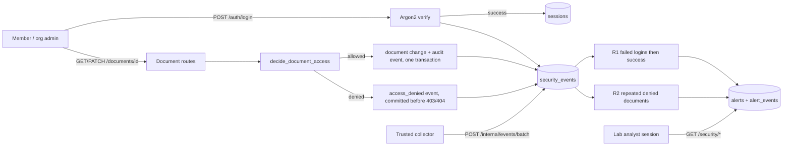

# Days 7–9 Implementation Walkthrough

Days 1–6 built the second half of the pipeline: validated events, PostgreSQL, R1, and alert
evidence. Days 7–9 add the first half. Real users log in, document routes enforce tenant
and ownership rules on the server, and those decisions become trusted security events
that feed the same detector pipeline.

```text
actual user behavior -> server authorization decision -> trusted event -> existing pipeline
```



Three ideas carry the whole milestone:

1. **Authentication establishes identity.** A login produces a session; every later request
   resolves that session to a user whose role and organization come from PostgreSQL.
2. **Authorization enforces boundaries and produces telemetry.** The server decides, and
   the decision itself, not a client claim, becomes the security event.
3. **R2 correlates denials into one episode.** Five distinct denied documents within five
   minutes opens an episode; further probing extends it instead of creating alert spam.

## Code map

| Path | Responsibility |
| --- | --- |
| `backend/migrations/002_application.sql` | Organizations, users, sessions, documents; contract and alert generalization |
| `backend/auth.py` | Argon2 hashing, opaque tokens, `require_user` / `require_analyst` / `require_organization_user` / `require_collector` |
| `backend/repositories/users.py` | User lookup, session create/lookup/revoke |
| `backend/routes/auth.py` | `POST /auth/login`, `POST /auth/logout`, `GET /auth/me` |
| `backend/audit.py` | Server-derived request context and `record_event` (same `parse_event` validation) |
| `backend/authorization.py` | Pure document ownership policy |
| `backend/repositories/documents.py` | Document reads and writes |
| `backend/routes/documents.py` | `GET/POST /documents`, `GET/PATCH /documents/{id}` |
| `detections/common.py` | Shared replay deduplication, ordering, duration helpers |
| `detections/denied_document_access.py` | Pure R2 rule with episodes |
| `backend/repositories/alerts.py` | Rule-neutral `AlertRecord` and one upsert path for both rules |
| `backend/detection_runner.py` | `run_failed_login_detection`, `run_denied_document_detection` |
| `scripts/seed.py` | Idempotent fictional organizations, users, and documents |
| `scripts/run_detection.py` | `--rule r1 \| r2 \| all` with R1 and R2 tuning flags |

## Authentication: small on purpose

```text
POST /auth/login {login, password}
  -> canonicalize login (trim + casefold)
  -> look up user; verify Argon2 hash (a dummy hash when the account is unknown)
  -> failure: record login_failed, commit, return 401 "invalid login or password"
  -> success: create session + record login_succeeded in ONE transaction
              return {access_token, expires_at, user}
```

- **Passwords:** Argon2id via `pwdlib[argon2]`. The project does not implement hashing.
- **Tokens:** 256 random bits. Only `sha256(token)` is stored; the raw token is returned
  once. A leaked `sessions` table does not contain usable credentials.
- **Session ID vs token:** events carry the separate opaque `session_id`, never the token.
- **Lifecycle:** eight-hour expiry (`SESSION_LIFETIME_MINUTES`), revocation on logout. No
  refresh tokens.
- **Same response for every failure:** unknown accounts and wrong passwords both return the
  identical `401`, and the dummy-hash verification keeps timing similar. Only the stored
  event's `metadata.reason` distinguishes `unknown_account` from `invalid_password`, which
  helps an analyst tell password spraying from guessing.
- **The request body is only credentials:** `extra="forbid"` rejects `actor_id`, `outcome`,
  or anything else a client might try to assert (`422`, and no event).

For a failed login on a known account, the event keeps `actor_id=null` (nobody
authenticated) but takes `organization_id` from the account, so R1 can correlate it with
the account's later success. An unknown account has no organization.

The static `ANALYST_TOKEN` from Days 5–6 is gone. The lab analyst is now a user with the
`lab_analyst` role and no organization, using the same session mechanism. The collector
token remains, but only for ingestion.

## Authorization policy

`decide_document_access(user, document)` is a pure function:

| Caller | Own document | Same-org, other owner | Other organization | Nonexistent ID |
| --- | --- | --- | --- | --- |
| Member | allowed | `403` + event `not_owner` | `404` + event `cross_organization` | `404` + event `not_found` |
| Organization admin | allowed | allowed | `404` + event `cross_organization` | `404` + event `not_found` |
| Lab analyst | `403` (no implicit document access) | `403` | `403` | `403` |

- Cross-organization and nonexistent documents return the **same** `404` body, so a caller
  cannot learn which IDs exist in another tenant. Only the stored event records which case
  it was.
- The denial event uses the **caller's** organization and records only the requested ID,
  never the document's title, body, or owning tenant.
- Owner and organization for new documents come from the session. A body containing
  `owner_id` or `organization_id` is rejected with `422`.
- A composite foreign key makes it impossible in PostgreSQL to store a document owned by a
  user outside its organization.

Access to `/security/*`:

| Credential | `/security/*` | `/internal/events/batch` | `/documents` |
| --- | --- | --- | --- |
| none / unknown token | 401 | 401 | 401 |
| collector token | 401 | allowed | 401 |
| member or org admin session | 403 | 401 | scoped |
| lab analyst session | allowed | 401 | 403 |

`401` means "not a valid credential for this realm"; `403` means "authenticated, but this
role may not do this."

## Business action and audit event

```text
successful PATCH /documents/{id}         denied GET/PATCH /documents/{id}
BEGIN                                    BEGIN
  load document, decide                    load document, decide
  UPDATE documents                         INSERT access_denied event
  INSERT document_updated event          COMMIT
COMMIT                                   return 403 / 404
return 200
```

A successful change and its audit event commit together or not at all. The test
`test_audit_failure_rolls_back_the_business_change` forces the audit insert to fail and
verifies that the update and the create both roll back. Denials have no business change,
but their event still commits before the response. If that write fails, the caller gets a
`500` instead of the document, and the attempt goes unrecorded (a documented gap, not
tamper-proof logging).

`source_ip` is the socket peer. `X-Forwarded-For` is ignored because no trusted proxy is
configured; under Docker the peer may be a bridge gateway address.

## R2: repeated denied document access

Input: `access_denied` events with `resource_type=document`. Grouping:
`(organization_id, actor_id)`.

```text
for each denial at time t (sorted by occurred_at, event_id):
    window = denials for the same (org, actor) with t - 5m <= occurred_at <= t
    if no open episode and COUNT(DISTINCT resource_id in window) >= 5:
        open episode; trigger = this event; evidence = window
    elif open episode and t - last_evidence_time <= 15m:
        append to evidence; suppression_until = t + 15m
    elif open episode:
        close it; this denial starts a fresh count
```

The current event counts (unlike R1, where the success is excluded) because it may be the
fifth document. Both window ends are inclusive.

**Why distinct resources?** Six requests for one stale bookmark look like this:

```text
12:00 doc-A  12:01 doc-A  12:02 doc-A  12:03 doc-A  12:04 doc-A  12:05 doc-A
-> 6 requests, 1 distinct document -> no alert
```

**Why episodes?** Without suppression, every additional denial after the fifth would be a
new alert. With an episode:

```text
12:00-12:04  5 distinct denied documents -> episode opens (alert created)
12:05 doc-F  12:06 doc-G                 -> same alert, evidence extended (alert updated)
12:30 ...    (>15 minutes of silence)    -> episode closed; a new crossing is a new alert
```

**Alert identity** is anchored to the event that first crossed the threshold:

```text
R2_REPEATED_DENIED_DOCUMENT_ACCESS:1.0:threshold=5:window_us=300000000:
cooldown_us=900000000:<organization_id>:<actor_id>:<threshold_crossing_event_id>
```

Later evidence changes `match_count` (distinct documents), `window_end`,
`suppression_until`, and the reason, but never the key, so reruns update one alert.
Analyst-owned `status` is preserved.

## Run it

```bash
python -m pip install -e '.[dev]'
docker compose up -d --wait
python -m scripts.migrate
python -m scripts.migrate --database-url-env TEST_DATABASE_URL
python -m scripts.seed            # prompts for one lab password shared by all seeded users
python -m pytest

uvicorn backend.api:create_app --factory
```

Seeded fictional accounts:

| Login | Role | Organization |
| --- | --- | --- |
| `alice@alpha.example.test` | member (owns `doc-alpha-001..003`) | `org-alpha` |
| `bob@alpha.example.test` | member (owns `doc-alpha-004`) | `org-alpha` |
| `admin@alpha.example.test` | organization admin (owns `doc-alpha-005`) | `org-alpha` |
| `dana@beta.example.test` | member (owns `doc-beta-001..003`) | `org-beta` |
| `admin@beta.example.test` | organization admin (owns `doc-beta-004`) | `org-beta` |
| `analyst@lab.example.test` | lab analyst | none |

Demo (in a second terminal, with `PW` set to the seed password):

```bash
API=http://127.0.0.1:8000
login() { curl -s -X POST $API/auth/login -H 'Content-Type: application/json' \
  -d "{\"login\":\"$1\",\"password\":\"$2\"}"; }
token() { python -c 'import sys,json; print(json.load(sys.stdin)["access_token"])'; }

BOB=$(login bob@alpha.example.test "$PW" | token)
curl -H "Authorization: Bearer $BOB" $API/documents/doc-alpha-004      # own: 200
for d in doc-alpha-001 doc-alpha-002 doc-alpha-003 doc-alpha-005 doc-beta-001; do
  curl -s -w " %{http_code}\n" -H "Authorization: Bearer $BOB" $API/documents/$d
done
curl -H "Authorization: Bearer $BOB" $API/security/alerts              # 403

for i in 1 2 3 4 5; do login alice@alpha.example.test wrong-guess; done
login alice@alpha.example.test "$PW"

python -m scripts.run_detection
python -m scripts.run_detection    # second run: nothing created

AN=$(login analyst@lab.example.test "$PW" | token)
curl -H "Authorization: Bearer $AN" $API/security/alerts
curl -H "Authorization: Bearer $AN" "$API/security/events?actor_id=user-bob&event_type=access_denied"
```

Observed output (abridged):

```text
doc-alpha-001: {"detail":"not permitted to access this document"} 403
doc-alpha-002: {"detail":"not permitted to access this document"} 403
doc-alpha-003: {"detail":"not permitted to access this document"} 403
doc-alpha-005: {"detail":"not permitted to access this document"} 403
doc-beta-001: {"detail":"document not found"} 404
security as bob: {"detail":"lab analyst role required"} 403

run 1: R1 created 1    R2 created 1
run 2: R1 created 0    R2 created 0, unchanged 1

R2_REPEATED_DENIED_DOCUMENT_ACCESS:1.0:threshold=5:window_us=300000000:cooldown_us=900000000:org-alpha:user-bob:app-88c7...
    user-bob in org-alpha was denied access to 5 distinct documents across 5 requests;
    5 distinct documents were first reached within 5 minutes
```

`GET /security/alerts/{alert_key}` returns the alert, `resource_ids` (the distinct
requested documents), `source_ips`, and every evidence event in time order.

To start over: `docker compose down -v`, then repeat the Compose, migration, and seed steps.

## SQL practice

R2's core question in SQL, for one actor at one instant:

```sql
SELECT organization_id, actor_id,
       COUNT(*)                    AS denials,
       COUNT(DISTINCT resource_id) AS distinct_documents
FROM security_events
WHERE event_type = 'access_denied'
  AND resource_type = 'document'
  AND occurred_at BETWEEN now() - interval '5 minutes' AND now()
GROUP BY organization_id, actor_id
HAVING COUNT(DISTINCT resource_id) >= 5;
```

`COUNT(*)` vs `COUNT(DISTINCT resource_id)` is the whole distinction between a stale link
and probing. This query uses a fixed window ending at `now()`; the detector evaluates a
window ending at **every** denial and adds episodes, which SQL alone does not express.

Why was each request denied?

```sql
SELECT occurred_at, actor_id, resource_id, metadata->>'reason' AS reason
FROM security_events
WHERE event_type = 'access_denied'
ORDER BY occurred_at;
```

## Tests

- `tests/test_application.py`: login success and session storage, identical failure
  responses, rejection of client-asserted identity, forwarding-header distrust, logout,
  expiry, member and admin listing scope, owner read/update with content-free audit,
  session-derived ownership on create, same-org `403`, cross-org `404` equal to missing,
  admin scope limits, analyst without document access, malformed IDs, audit-failure
  rollback, and R1 and R2 end to end through real routes with rerun idempotency.
- `tests/test_denied_document_access.py`: the pure R2 rule. Covers below/at/above
  threshold, repeated documents, non-document denials, isolation, both window boundaries,
  key anchoring, extension, the exact cooldown boundary, cooldown expiry, post-episode
  threshold, shuffle/replay, source IPs, configuration, and validation.
- `tests/test_r2_persistence.py`: reruns without duplicates, extension preserving analyst
  status, separate alerts after cooldown, and run audit records.
- `tests/test_api.py`: the full credential matrix, now including member and admin sessions
  against `/security/*`.

## Limitations

- Local lab authentication only: no MFA, password reset, account lockout (intentionally
  omitted so R1 is demonstrable), rate limiting, or distributed session store.
- Every seeded user shares one lab password.
- Organization admins manage documents only; membership and role management arrive with
  R3.
- Unauthorized `/security/*` attempts are rejected but not recorded as events.
- A failed denial-event write leaves that attempt unrecorded (the request still fails).
- Behind Docker or a proxy, `source_ip` may be the gateway; proxy headers are not trusted.
- The detector still rescans all events on every run.
- R2 is threshold-based. Slow probing under five documents per window, or probing spread
  across accounts, is not detected.
