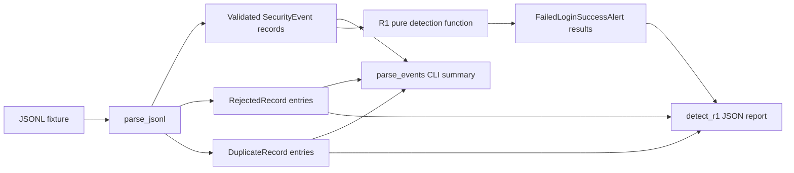

# Days 1–4 Implementation Reference

This document inventories what is implemented through Days 1–4 of the project roadmap.
It describes the code as it exists now, not the later persistence, API, application, or
investigation features.

## Implemented scope

Days 1–2 provide:

- a typed security-event model;
- strict validation and normalization for individual event records;
- resilient JSONL batch parsing that reports bad records while retaining valid ones;
- deterministic ordering, replay collapsing, and batch-wide conflict exclusion;
- fictional valid, suspicious, boundary, malformed, and duplicate fixtures;
- a command-line parser summary; and
- behavioral tests for parsing, validation, normalization, ordering, and CLI behavior.

Days 3–4 add:

- the R1 failed-logins-followed-by-success rule as pure Python logic;
- configurable threshold and lookback window;
- deterministic alert identities and ordered evidence;
- replay handling based on source content rather than collection time;
- a JSON-producing detection CLI; and
- behavioral tests for thresholds, boundaries, entity isolation, input order, duplicate
  handling, configuration, fixture results, and CLI behavior.

## Current data flow



The parser is the shared input boundary. The detector receives only validated
`SecurityEvent` objects and has no dependency on HTTP, a database, or CLI argument
handling. Both command-line programs call the same parser, and the detection CLI calls
the same pure detection function that tests call directly.

## Repository components

### `scripts/event_parser.py`

This module defines the event contract and all parsing, validation, normalization, and
batch-reporting behavior.

#### Controlled values and limits

- `EVENT_TYPES`: `login_failed`, `login_succeeded`, `access_denied`,
  `document_downloaded`, and `role_changed`.
- `SOURCES`: `application`, `fixture`, and `cloudtrail`.
- `OUTCOMES`: `success`, `denied`, and `failure`.
- `ROLES`: `member`, `organization_admin`, and `lab_analyst`.
- `RESOURCE_TYPES`: `document`, `alert`, and `admin_route`.
- `SUPPORTED_SCHEMA_VERSIONS`: only the exact string `"1.0"`.
- `ALLOWED_FIELDS`: the complete allow-list accepted in an event object. Unknown
  top-level fields are rejected.
- `FORBIDDEN_METADATA_KEYS`: secret or sensitive names that cannot appear at any nesting
  level in metadata, including passwords, tokens, cookies, and document content.
- `MAX_LINE_BYTES`: 16,384 bytes per JSONL record.
- `MAX_STRING_LENGTH`: 256 characters for first-class string fields and metadata string
  values.
- `MAX_METADATA_BYTES`: 4,096 UTF-8 bytes after compact JSON serialization.
- `CONTROL_CHARACTERS`: rejects non-printing control characters other than the whitespace
  excluded by the expression.

#### Data models

`EventValidationError`

- A `ValueError` subtype used for event and line validation failures.
- Enables callers and tests to distinguish invalid input from unrelated failures.

`SecurityEvent`

- An immutable dataclass containing the normalized event contract.
- Required first-class fields include identifiers, timestamps, source, type, outcome,
  request ID, schema version, and metadata.
- Nullable fields support event-specific context such as actor, attempted account, role
  transition, session, IP address, and resource.
- `to_dict()` serializes the complete event and renders timestamps as UTC ISO 8601 values
  ending in `Z`.

`RejectedRecord`

- An immutable pair of `line_number` and human-readable `reason`.
- Represents one rejected JSONL line without terminating the rest of the batch.

`DuplicateRecord`

- Identifies a source-equivalent replay by its line, event ID, and retained line.
- Reports benign replay separately from malformed or conflicting input.

`ParseResult`

- Holds immutable tuples of valid `events`, `rejected` records, and `duplicates`, plus
  `lines_read`.
- `event_type_counts` calculates sorted counts from accepted events.

#### Public functions

`parse_event(record)`

Validates one already-decoded object and returns a normalized `SecurityEvent`.

Its processing includes:

1. Require a JSON object.
2. Reject unknown top-level fields.
3. Validate controlled event type and outcome values.
4. Read optional event-specific fields and validate role/resource choices.
5. Enforce the event shape and required outcome.
6. Canonicalize `attempted_account` with Unicode-aware `casefold()`.
7. Validate IDs and strings, parse timestamps, normalize IP addresses, and validate
   metadata.
8. Require `schema_version` to be the exact supported string `"1.0"`.

Event-specific rules currently enforced:

| Event type | Required shape |
| --- | --- |
| `login_failed` | `organization_id`, `attempted_account`, outcome `failure`; actor, session, and IP may be absent |
| `login_succeeded` | `organization_id`, `attempted_account`, `actor_id`, `session_id`, outcome `success` |
| `access_denied` | `organization_id`, `actor_id`, `session_id`, `resource_type`, outcome `denied`; a document denial also requires `resource_id` |
| `document_downloaded` | `organization_id`, `actor_id`, `session_id`, document `resource_type`, `resource_id`, outcome `success` |
| `role_changed` | `organization_id`, `actor_id`, `session_id`, `target_actor_id`, distinct valid `previous_role` and `new_role`, outcome `success` |

`parse_jsonl(path)`

- Reads the file as bytes so invalid UTF-8 can be reported explicitly.
- Processes one line at a time and tracks the physical line number.
- Rejects oversized, invalid UTF-8, blank, malformed JSON, and invalid event lines
  independently.
- Continues after a rejected line, preserving valid records elsewhere in the file.
- Collapses source-equivalent event IDs while ignoring `ingested_at`, retains the
  occurrence with the earliest collection time, and reports every other occurrence as a
  duplicate.
- Excludes and rejects every occurrence of an event ID when any source content conflicts,
  including later records that match a previously seen version.
- Sorts accepted events by `(occurred_at, event_id)` before returning a `ParseResult`.
- Propagates file-system errors to the calling CLI, which reports them.

`events_have_same_source_content(first, second)`

- Compares every normalized `SecurityEvent` field except `ingested_at`.
- Supplies one equivalence definition to the parser and detector.

#### Internal validation helpers

- `_validate_event_shape(...)` enforces outcome and field combinations for each event type.
- `_require_present(...)` emits consistent missing event-specific field errors.
- `_require_string(...)` enforces presence, string type, non-empty content, trimming,
  length, and control-character rules.
- `_optional_string(...)` accepts an absent or null value and otherwise delegates to
  `_require_string`.
- `_require_choice(...)` and `_optional_choice(...)` constrain controlled vocabularies.
- `_require_timestamp(...)` accepts ISO 8601 timestamps only when timezone-aware and
  converts them to UTC.
- `_optional_ip(...)` validates IPv4/IPv6 and emits the canonical address representation.
- `_validate_metadata(...)` requires an object and enforces its serialized byte limit.
- `_validate_metadata_values(...)` recursively checks dictionaries and lists for forbidden
  key names, oversized strings, and control characters.
- `_format_utc(...)` serializes an aware `datetime` in UTC with a `Z` suffix.

### `scripts/parse_events.py`

This is the Days 1–2 human-readable parser CLI.

#### Core functions

`build_parser()`

- Requires a JSONL file path.
- Supports `--strict`, which makes any rejected records affect the process status.

`format_report(result)`

- Produces a text report containing lines read, valid, rejected, and duplicate counts,
  sorted event-type counts, line-specific rejection reasons, and retained-line details for
  duplicates.

`main(argv=None)`

- Parses CLI arguments and calls `parse_jsonl`.
- Prints a readable file error and returns status `1` when the file cannot be read.
- Prints the complete summary for a readable file.
- Returns status `2` in strict mode when at least one record was rejected.
- Otherwise returns status `0`, including for batches containing only benign duplicate
  replays.

### `detections/failed_login_success.py`

This module implements R1 independently of transport and storage concerns.

#### Rule constants

- `RULE_ID`: `R1_FAILED_LOGINS_FOLLOWED_BY_SUCCESS`.
- `RULE_VERSION`: `1.0`.
- `DEFAULT_THRESHOLD`: five failed logins.
- `DEFAULT_WINDOW`: ten minutes.

#### Data models

`FailedLoginSuccessConfig`

- Immutable configuration with `threshold` and `window`.
- Rejects thresholds below one and windows that are zero or negative.

`FailedLoginSuccessAlert`

- Immutable R1 result carrying the deterministic alert key, rule identity, severity,
  correlated entity, actor, time window, configured threshold, exact window
  microseconds, counts, evidence IDs, source IPs, session, and reason.
- `to_dict()` converts tuple fields to JSON-compatible lists and timestamps to UTC `Z`
  strings.

#### Detection function

`detect_failed_logins_followed_by_success(events, config=None)`

1. Uses default configuration when none is supplied.
2. Deduplicates and deterministically sorts the supplied events.
3. Ignores records without an organization or attempted account.
4. Groups failed logins by `(organization_id, attempted_account)`.
5. At each successful login at time `t`, selects failures in
   `[t - configured_window, t)`.
6. Creates one alert when the qualifying failure count meets or exceeds the threshold.
7. Returns alerts as a tuple in deterministic success-event order.

Each alert:

- has medium severity;
- uses
  `R1_FAILED_LOGINS_FOLLOWED_BY_SUCCESS:1.0:threshold=<count>:window_us=<microseconds>:<success_event_id>`
  as its stable key;
- records the threshold and exact window duration used to produce it;
- retains failures in deterministic chronological/event-ID order;
- appends the successful login to `evidence_event_ids`;
- includes unique, non-null source IPs from all evidence in sorted order;
- carries the successful login's actor and session IDs; and
- describes the failure count, canonical account, and organization in its reason; and
- is distinct for each qualifying successful login.

The rule intentionally groups by account and organization. Source IPs are evidence, not
the grouping key, because multiple addresses may belong to one attempt sequence and one
address may be shared.

#### Internal helpers

`_deduplicate_and_sort(events)`

- Collapses source-equivalent records that share an event ID and retains the earliest
  `ingested_at`.
- Raises `ValueError` when the same ID refers to conflicting source content because a
  direct detector call has no line-level rejection channel.
- Sorts unique events by `(occurred_at, event_id)`.

`_timedelta_microseconds(value)`

- Converts a `timedelta` to an exact integer without float precision loss for alert
  identity and output.

`_format_utc(value)`

- Produces UTC ISO 8601 timestamps ending in `Z` for alert serialization.

### `scripts/detect_r1.py`

This is the Days 3–4 batch detection CLI.

#### Core functions

`build_parser()`

- Requires a JSONL file path.
- Accepts `--threshold` to override the default failure count.
- Accepts `--window-minutes` to override the ten-minute window.
- Accepts `--strict` to return a failing status after reporting rejected input lines.

`main(argv=None)`

- Parses the input with `parse_jsonl`.
- Returns status `1` and emits a JSON error when the file cannot be read.
- Builds `FailedLoginSuccessConfig` from CLI options.
- Runs the pure R1 detector on accepted events.
- Prints deterministic, indented JSON containing:
  - input line count;
  - accepted event count;
  - rejected line numbers and reasons;
  - duplicate line, event ID, and retained-line details;
  - alert count; and
  - fully serialized alerts and evidence.
- Returns status `2` when strict mode sees rejected records, otherwise status `0`.

`_positive_int(value)`

- Converts CLI threshold/window values to integers.
- Raises an `argparse` error for values below one.

### `detections/__init__.py` and `scripts/__init__.py`

These files make the detection and script directories importable packages.
`detections/__init__.py` also states the package boundary: detection rules are intended to
remain pure.

### `fixtures/days_1_2.jsonl`

The main 20-line synthetic batch contains:

- normal successful and failed logins;
- five qualifying Alice failures followed by success;
- one Alice failure just outside the ten-minute window;
- same-account activity in another organization;
- activity for other accounts;
- denied document and analyst-resource access;
- a document download and role change for future rules;
- a failed login with unknown actor and missing IP;
- one malformed JSON line; and
- one source-equivalent replay with a later `ingested_at`.

Current expected parser result: 18 valid events, one rejected record, and one duplicate
report. Current R1 result: one alert for `alice@example.test` in `org-alpha`, based on
failures `evt-004` through `evt-008` and success `evt-009`.

All fixture identities and addresses are fictional. The IPv4 ranges used are documentation
ranges.

### `fixtures/invalid_events.jsonl`

This fixture verifies that one valid record survives alongside invalid JSON, a non-object
record, missing fields, a naive timestamp, an invalid IP address, forbidden metadata, an
unknown field, and a blank line.

### `fixtures/expected/days_1_2.json`

This independently written oracle records:

- line, acceptance, rejection, duplicate, and event-type counts;
- expected deterministic event ordering;
- expected rejected and duplicate lines; and
- the hand-checked R1 entity, window boundaries, qualifying evidence, and excluded
  out-of-window event.

Keeping expected results outside detector code prevents tests from deriving the expected
answer from the implementation under test.

### Tests

`tests/test_event_parser.py` covers:

- comparison with the independent fixture expectations;
- retention of valid records when neighboring records are invalid;
- account, timestamp, and IPv6 normalization;
- conversion of offset timestamps to UTC;
- invalid required values, timezone, source, IP, outcome, organization, schema version,
  metadata, secret keys, and unknown fields;
- rejection of non-object records;
- order-independent replay collapsing with earliest-ingestion retention;
- order-independent conflict exclusion, including an `A, B, A` sequence;
- deterministic timestamp/event-ID ordering;
- reporting blank and malformed lines; and
- normal and strict parser CLI statuses.

`tests/test_failed_login_success.py` covers:

- below, exactly at, and above the threshold;
- inclusive window start and exclusive success-time boundary;
- account and organization isolation;
- shuffled input and source-equivalent replay determinism;
- empty source-IP evidence;
- direct-call conflicts and parser-to-detector conflict exclusion;
- custom threshold and window;
- configuration-aware and precision-safe alert identities;
- separate alerts for distinct qualifying successes;
- invalid configuration;
- comparison to the hand-checked fixture result; and
- detection CLI evidence, rejection reporting, strict mode, and argument validation.

### Project configuration

`pyproject.toml`:

- requires Python 3.10 or newer;
- defines the `security-monitoring-lab` package at version `0.1.0`;
- uses setuptools as the build backend;
- discovers `detections*` and `scripts*` packages;
- provides pytest 8 as the development dependency; and
- configures pytest to run `tests/` quietly.

`.gitignore` excludes the local virtual environment, Python caches, pytest cache, package
metadata, compiled Python files, and `.env`.

## Reproducing the implemented behavior

```bash
python3 -m venv .venv
source .venv/bin/activate
python -m pip install -e '.[dev]'

python -m scripts.parse_events fixtures/days_1_2.jsonl
python -m scripts.parse_events fixtures/invalid_events.jsonl --strict

python -m scripts.detect_r1 fixtures/days_1_2.jsonl
python -m scripts.detect_r1 fixtures/days_1_2.jsonl \
  --threshold 3 \
  --window-minutes 5

python -m pytest
```

Expected CLI status conventions:

- `0`: command completed; non-strict mode may still report rejected records.
- `1`: the input file could not be read.
- `2`: strict mode found rejected records, or `argparse` rejected an invalid argument.

## Security and correctness properties already present

- Unrecognized top-level input is rejected instead of silently trusted.
- Event outcome and required context are checked against event type.
- Timezone-aware timestamps are normalized to UTC.
- Account identifiers are canonicalized before correlation.
- IP addresses are validated and canonicalized.
- Sensitive metadata key names are recursively rejected.
- Input sizes are bounded at line, string, and metadata levels.
- One malformed record does not erase the rest of a batch.
- Benign replay is distinguished from malformed or conflicting input.
- Conflicting IDs are wholly excluded regardless of line order.
- Event and alert output ordering is deterministic.
- R1 does not combine accounts or organizations.
- R1 retains raw event IDs and observed IPs as inspectable evidence.
- R1 identity includes its rule, configuration, and triggering success event.
- Source-equivalent in-memory replay does not create duplicate R1 results in one
  invocation.

## Current boundaries and limitations

The following roadmap components are not implemented yet:

- PostgreSQL, migrations, or persistent event/alert records;
- database uniqueness and alert upserts across separate runs;
- `alert_events`, case notes, detection-run history, or suppression state;
- FastAPI ingestion, application, or investigation endpoints;
- authentication, server-side authorization, users, organizations, or documents;
- server-generated application audit events;
- R2, R3, and R4;
- scheduling or incremental lookback processing;
- a React application or analyst interface;
- Docker Compose or CI;
- Splunk export/searches; and
- AWS S3, IAM, or CloudTrail integration.

Specific Days 1–4 limits:

- JSONL duplicate detection exists only within one parser invocation.
- The detector's replay protection exists only in memory; no alert is persisted.
- The parser validates timestamp shape and timezone but does not enforce that
  `ingested_at` is on or after `occurred_at`.
- Allowed fields that are irrelevant to a particular event type are not universally
  prohibited.
- Metadata is bounded and screened for named secrets, but it is not a general-purpose
  data-loss-prevention mechanism.
- Batch parsing loads all accepted events into memory before detection.
- R1 detects only failures for one canonical account and organization followed by a
  success. It does not detect slow guessing outside the window or password spraying
  across accounts.
- A matching sequence warrants investigation but does not prove account compromise.
- Source IP is contextual evidence and cannot reliably identify a person or device.
- Event authenticity is not established by local fixture parsing; trusted ingestion and
  server-derived fields belong to later milestones.

## Roadmap handoff

The Days 1–4 output is deliberately shaped for Days 5–6:

- `SecurityEvent` is the validated object to persist.
- `event_id` is the future database uniqueness key.
- `FailedLoginSuccessAlert.alert_key` is the future deterministic alert upsert key.
- `evidence_event_ids` supplies the future `alert_events` relationships.
- rule ID/version, entity, window, severity, and reason provide the future alert fields.
- parser rejection details can support future ingestion responses and operational
  reporting.

Persistence must preserve these semantics while adding transactions, durable replay
protection, protected ingestion, and authorized event/alert reads.
