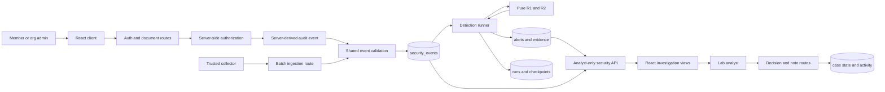
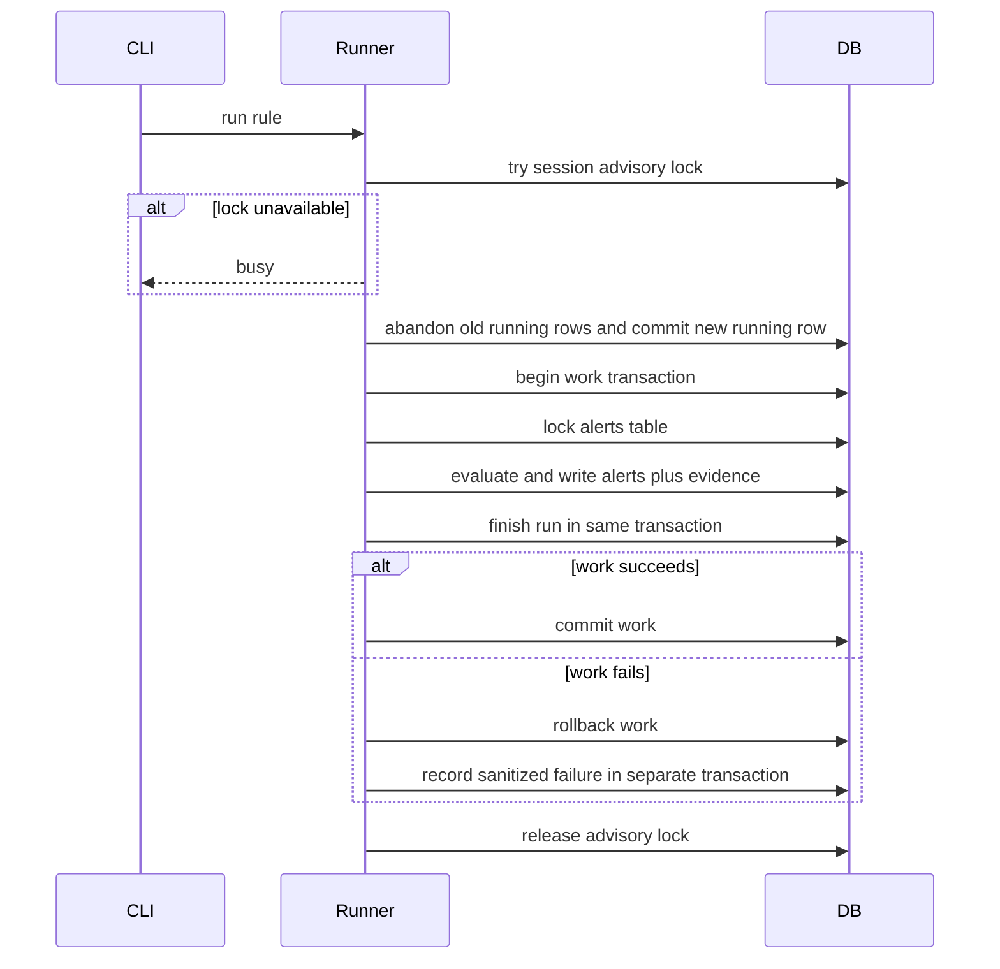
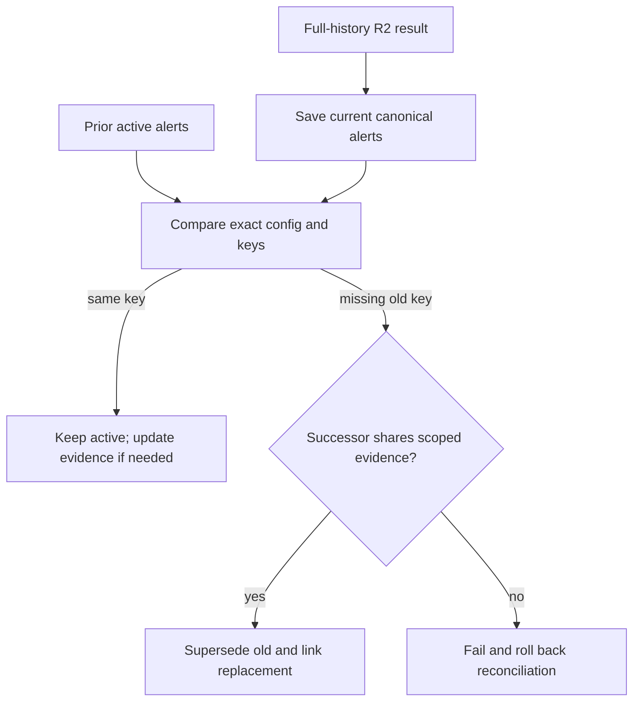
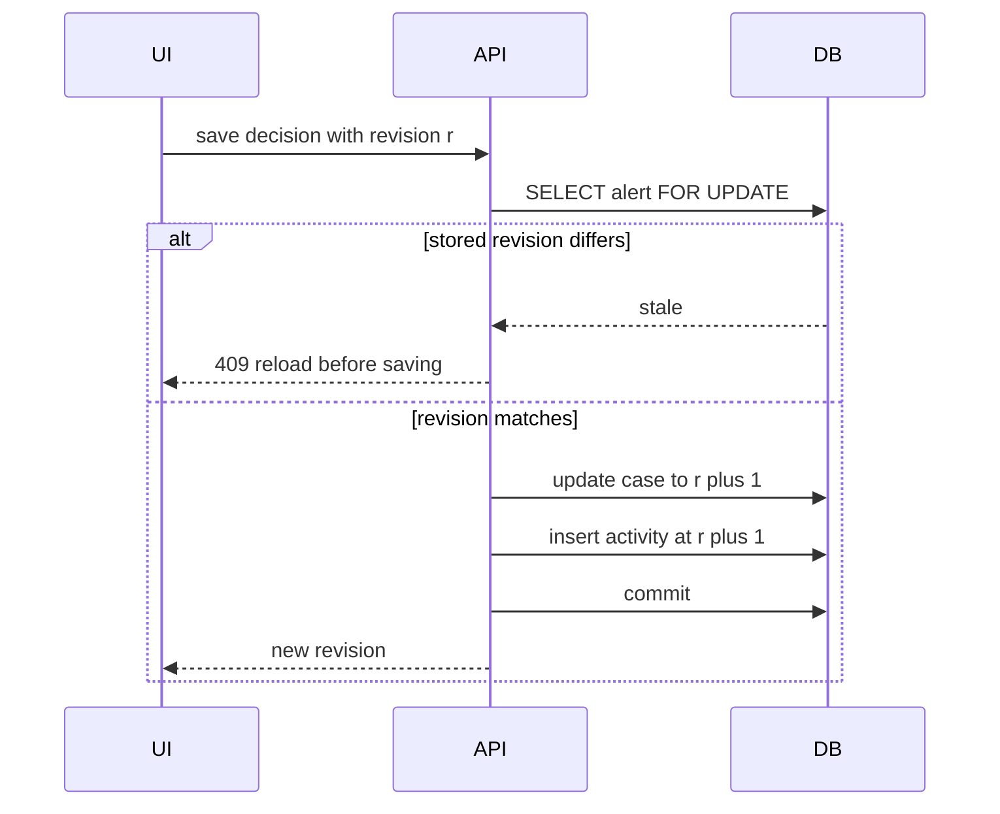

# Security Monitoring Lab: MVP Hardening Interview Guide

Recorded October 3, 2026. This guide consolidates the original MVP and hardening
Sections 1–4 into one technical narrative. It is an interview study guide and an
as-built architecture reference, not a claim that this local lab is a production SIEM.

## 1. How to use this guide

There are three useful reading paths:

1. For a two-minute overview, read the executive summary, architecture, and interview
   pitch.
2. For system-design discussion, read the hardening chronology and cross-cutting deep
   dives.
3. For evidence, use the code, migration, test, benchmark, and investigation maps near
   the end.

Evidence labels used here:

- **Implemented:** present in the current repository.
- **Locally verified:** exercised by the recorded local test or acceptance run.
- **Hosted verified:** exercised by a cited hosted CI revision.
- **Planned:** design work that has not been implemented.

The committed history currently ends at `3db1665`, which contains Section 3.
Section 4 is implemented and locally verified in the working tree, but the hosted CI
run cited in the Section 4 record predates that working tree. That distinction matters:
do not say that final Section 4 is CI-green until its exact revision is published and
passes.

Primary sources:

- [Hardening Section 1](hardening_baseline.md)
- [Hardening Section 2](hardening_section2.md)
- [Hardening Section 3](hardening_section3.md)
- [Hardening Section 4](hardening_section4.md)
- [Technical specification](TECHNICAL.md)
- [README](../README.md)
- [Hardening roadmap](../MVP_Hardening_Roadmap.md)
- [Improvement timeline](../MVP_Completion_Timeline.md)

### Contents

1. Executive summary and interview pitch
2. Current architecture and trust boundaries
3. Original MVP baseline
4. Hardening chronology: recovery, R2 reconciliation, incremental R1, and case workflow
5. Cross-cutting transactions, locks, determinism, late data, and security tradeoffs
6. Migrations, testing evidence, operations, and investigation artifacts
7. Limitations, interview stories, likely questions, and cheat sheets
8. Code map, git chronology, and carefully scoped claims

## 2. Executive summary

This project is a portfolio-scale security monitoring and investigation lab around a
fictional multi-tenant document application. Members and organization administrators
authenticate, access documents, and generate server-derived security telemetry. A
separate trusted collector can ingest fixtures or future external telemetry. PostgreSQL
stores validated facts. Pure Python rules detect suspicious patterns. A FastAPI
investigation API and React client let a lab analyst inspect raw evidence and record a
case decision.

The original MVP already had important strengths:

- a strict, versioned event contract;
- deterministic R1 and R2 rules;
- replay-safe event and alert persistence;
- server-side authentication, authorization, and tenant isolation;
- raw alert-to-event evidence links;
- suspicious and benign end-to-end scenarios;
- a minimal analyst UI and automated backend/frontend checks.

The hardening work did not replace that architecture. It addressed four specific classes
of risk:

1. **Recovery:** crashes, database failures, concurrent workers, and partial detector
   writes.
2. **Late-data correctness:** a late R2 denial could change the threshold-crossing event
   and leave two alerts appearing current.
3. **Scale with correctness:** R1 loaded full history on every run, and commit visibility
   made a simple timestamp checkpoint unsafe.
4. **Security and investigation integrity:** HTTP work and read results needed bounds,
   while case decisions needed history and concurrency protection.

The central design principle is:

> PostgreSQL stores validated facts and transactional state; pure detectors decide which
> facts form suspicious patterns; analysts interpret those patterns. Server-side code
> owns every trust decision.

### Interview pitch

> I built a multi-tenant document-security lab with deterministic Python detections over
> PostgreSQL telemetry. The MVP already had strict validation, replay-safe ingestion,
> tenant authorization, evidence-linked alerts, and a React investigation UI. I then
> hardened it in four steps: transaction and crash recovery, reconciliation of late R2
> events without deleting case history, snapshot-aware incremental R1 backed by
> benchmarks, and a bounded API with revision-safe analyst case management. I preserved
> pure rule semantics, tested failure boundaries directly, and documented the limits:
> R2 still scans full history, offset pages are not exports, and this remains a local lab.

## 3. Current architecture



### Layer boundaries

| Layer | Responsibility | Representative files |
| --- | --- | --- |
| Event contract | Normalize and validate immutable telemetry | [`security_events/`](../security_events/) |
| Pure detection | Deterministic pattern evaluation without HTTP or SQL | [`detections/failed_login_success.py`](../detections/failed_login_success.py), [`detections/denied_document_access.py`](../detections/denied_document_access.py) |
| Application API | Authentication, documents, authorization, server audit | [`backend/routes/`](../backend/routes/), [`backend/audit.py`](../backend/audit.py) |
| Persistence | Parameterized SQL, events, alerts, runs, checkpoints, cases | [`backend/repositories/`](../backend/repositories/) |
| Orchestration | Locks, transactions, scan policy, recovery | [`backend/detection_runner.py`](../backend/detection_runner.py), [`backend/r1_processing.py`](../backend/r1_processing.py) |
| Investigation API | Analyst-only bounded reads and case writes | [`backend/routes/security.py`](../backend/routes/security.py) |
| UI | Thin role-aware client; no authorization decisions | [`frontend/src/`](../frontend/src/) |
| Operations | Migrate, seed, detect, reset, benchmark, scenarios | [`scripts/`](../scripts/) |

The pure functions are deliberately reusable. The file CLI and database runner call the
same rules; database concerns such as transactions, checkpoints, replacement history,
and analyst-owned state remain outside detection logic.

## 4. Trust boundaries and threat model

### Protected assets

- user credentials and opaque sessions;
- organization membership and document ownership;
- document content;
- validated telemetry and alert evidence;
- analyst notes, dispositions, and case history;
- detector progress and reconciliation state.

### Credential realms

| Realm | Credential | Authorized surface |
| --- | --- | --- |
| Application user | Opaque bearer session | `/auth/*` and tenant-scoped `/documents*` |
| Lab analyst | Opaque bearer session plus current `lab_analyst` role | `/security/*`; no implicit document access |
| Trusted collector | Static collector bearer secret | `POST /internal/events/batch` only |

The realms are intentionally non-interchangeable. A user session is not a collector
credential, and the collector secret is not a user session. Missing or invalid
credentials return `401`; a valid session with the wrong role returns `403`.

Authentication uses Argon2id through `pwdlib` for human passwords. Unknown logins are
checked against a dummy hash to reduce account-existence timing differences. Successful
login creates a 256-bit random token, stores only its SHA-256 digest, and returns the raw
token once. Sessions are expiring and revocable; authorization re-reads current user
role and organization from the database.

Document access is always decided on the server:

- members may access documents they own;
- organization administrators may access documents in their organization;
- nobody may access another organization's documents;
- the lab analyst has no organization and therefore receives no implicit document
  access.

The API preserves a deliberate response distinction:

- same-organization ownership denial is `403`;
- a foreign-organization or nonexistent document is uniformly `404`.

This prevents an ordinary user from learning whether a guessed foreign document exists.
The denial event records the requesting actor's organization and a safe reason, not
foreign tenant or document content.

## 5. Original MVP baseline

The original MVP was not merely a parser demo. It established the system's core contracts
before hardening.

### 5.1 Event contract and replay semantics

Events use schema version `"1.0"`, timezone-aware timestamps normalized to UTC, controlled
event/source/outcome values, bounded metadata, and event-specific required fields.
Application clients cannot assert trusted identity, organization, source IP, or outcome;
server routes derive those values.

`event_id` is the replay identity:

- equivalent source content is a replay and remains stored once;
- the first ingestion timestamp is retained;
- the same ID with conflicting source content rejects the entire ingestion batch;
- unrelated records are not partially committed when a conflict occurs.

The database primary key enforces uniqueness, while
[`backend/repositories/events.py`](../backend/repositories/events.py) compares normalized
source content after an `ON CONFLICT DO NOTHING`. This provides a defined idempotency
mechanism rather than blindly ignoring every duplicate key.

### 5.2 Application audit behavior

The application emits `login_failed`, `login_succeeded`, `access_denied`,
`document_created`, and `document_updated` events. Successful document changes and their
audit records commit in one transaction. If the audit insert fails, the business change
rolls back.

A denied document request has no business write to pair with. Its audit event is committed
before returning the denial. If the audit write itself fails, the route returns `500`
while still withholding the document. The project explicitly does not claim lossless or
tamper-proof audit storage.

### 5.3 R1: failed logins followed by success

R1 groups by `(organization_id, attempted_account)`. A null organization remains a real
group so the tenant-less analyst account can be protected.

For each success at time `t`, it counts failures in:

```text
[t - 10 minutes, t)
```

The lower boundary is inclusive; a failure at the exact success timestamp is excluded.
The default threshold is five. Every qualifying success creates its own deterministic
alert:

```text
rule + version + threshold + window_microseconds + success_event_id
```

Threshold and exact window are in the key so differently tuned configurations cannot
collide. The success event is a stable anchor: late qualifying failures extend evidence
on the same alert instead of creating a second key.

### 5.4 R2: repeated denied document access

R2 considers only `access_denied` events with `resource_type=document`, grouped by
`(organization_id, actor_id)`.

At each denial time `t`, it examines:

```text
[t - 5 minutes, t]
```

Both boundaries are inclusive, and the current denial can be the fifth distinct document.
After opening, every denial within 15 minutes of the previous denial extends the episode.
A larger gap closes it; a later episode must cross the threshold again.

R2's identity uses the event that first crosses the threshold:

```text
rule + version + threshold + window + cooldown + organization + actor + trigger_event_id
```

That identity correctly keeps later in-episode evidence on the same alert, but it creates
a late-data problem: an earlier event arriving later can move the canonical crossing to a
different event ID. Section 2 addresses that without changing the pure rule.

### 5.5 Persistence and investigation

Migrations 001–002 introduced:

- validated `security_events`;
- deterministic `alerts`;
- foreign-keyed `alert_events`;
- `detection_runs`;
- organizations, users, sessions, and documents;
- R2's generic alert shape, cooldown fields, and evidence role.

`alerts.status` was analyst-owned from the start. Detector upserts refreshed derived
fields and evidence but did not overwrite status. The analyst UI exposed list/detail
views and raw, ordered evidence. The MVP had status but not dispositions, notes,
append-only activity, or revision-safe writes.

### 5.6 Baseline verification

The v0.1 release record reported 134 backend tests and seven frontend tests. Suspicious
and benign scenarios ran through the real API:

- suspicious: five Alice login failures followed by success, plus Bob denied access to
  five distinct documents;
- benign: four login failures, plus repeated denial of one document.

The second detector run was expected to be idempotent: no duplicate alerts and unchanged
evidence.

## 6. Hardening chronology

## 6.1 Section 1: baseline, atomicity, and recovery

### Problem

The MVP's successful detector work was transactional, but the operational failure model
needed stronger proof:

- a process could die after recording `running`;
- concurrent workers could overlap before reaching the table lock;
- a database outage could prevent the failure row from being updated;
- raw exception text risked exposing sensitive values;
- the CLI needed to represent R1 success and R2 failure separately.

### Design

The runner separates **observability state** from the **atomic detection result**:



The initial `running` row is committed separately so a crash is observable. Alerts,
evidence, and `succeeded` status commit together. Failure recording occurs only after the
work transaction rolls back.

### Locks and abandoned runs

`pg_try_advisory_lock(704511862)` is session-scoped and excludes all detector/backfill
entry points using this runner. A second process exits `busy`; it does not wait
indefinitely or relabel the active process.

The next worker may mark old `running` rows `abandoned` only after it owns the advisory
lock. Elapsed age alone is not proof that a worker died. Owning the same session-level
lock proves that the previous lock-holding session no longer owns it. The alerts table
still receives an `EXCLUSIVE` lock during evaluation and writes.

### Failure behavior

Failures are reduced to safe categories such as:

- `checkpoint_required`;
- `checkpoint_clock_regression`;
- `database_unavailable`;
- `database_error`;
- `detector_error`.

The database and structured logs do not persist arbitrary exception text. A failed run
keeps available scan range/count information but records zero committed alert writes.

If the PostgreSQL connection is already unusable, even failure recording can fail. The
runner logs a sanitized `detection_failure_record_unavailable` event and exits nonzero.
The row may remain `running` until a later healthy worker takes the lock and marks it
abandoned. This is an explicit degraded case, not hidden as success.

### Evidence

Migration [`003_run_recovery.sql`](../backend/migrations/003_run_recovery.sql) adds
`abandoned` and duration. [`tests/test_detection_recovery.py`](../tests/test_detection_recovery.py)
tests:

- failure during evidence replacement restores prior evidence and analyst status;
- failure immediately before commit leaves no partial result;
- killed worker recovery;
- concurrent `busy` behavior;
- database outage while recording failure;
- lost connections;
- partial CLI success and nonzero exit.

The Section 1 record reports 143 backend tests with PostgreSQL available. An earlier
64-passed/70-skipped run did not prove persistence or API behavior.

### Interview takeaway

> A run ledger and detector result have different atomicity needs. I committed the
> running marker early for observability, but committed alerts, evidence, progress, and
> success as one result. Crash recovery relies on lock ownership, not a stale timeout.

## 6.2 Section 2: R2 late-event reconciliation

### Reproduced defect

The first five denials in the fixture opened an R2 episode at `denial-4`. A sixth denial
was ingested later but had an earlier event time. Full recomputation moved the first
threshold crossing to `denial-3`. Because the trigger ID is part of the key, simple upsert
left both keys visible as current.

Changing the pure key to an arbitrary mutable episode identity would not by itself solve
episode merges, analyst history, or backward compatibility. The chosen design treats
detection results and case history as related but distinct records.

### Reconciliation algorithm

Migration [`004_r2_reconciliation.sql`](../backend/migrations/004_r2_reconciliation.sql)
adds:

- `alerts.detection_state`: `active` or `superseded`;
- `alerts.needs_review`;
- `alert_replacements(old_alert_key, new_alert_key)`.

R2 still recomputes every eligible denial in event-time order. Under the runner's alert
lock and transaction, `reconcile_denied_document_alerts`:

1. loads active prior episodes for the exact rule version, threshold, window, and
   cooldown;
2. saves every newly computed canonical alert;
3. identifies prior active keys absent from the new result;
4. finds successors sharing at least one evidence event for the same organization and
   actor;
5. marks the old result superseded and writes replacement links;
6. propagates a review requirement when prior closed or unresolved work is replaced.

If an obsolete result has no evidence-backed successor, reconciliation raises and the
entire transaction rolls back. It does not silently delete or supersede unexplained
history.



### Why preserve superseded alerts?

Superseded means “no longer the current detector interpretation,” not “analyst closed
the case.” The old row retains:

- its original key;
- its evidence links;
- analyst status and later case history;
- links to its replacement or replacements.

The default list hides superseded results, while `include_superseded=true` exposes
history. Alert detail exposes predecessor and successor links.

### Tradeoff

The design is correctness-first and auditable, but R2 remains O(eligible denial history)
per run and can retain a long episode in memory. An incremental R2 would require a durable
affected-entity feed or persisted episode state plus safe rewind/reconciliation. A short
lookback is incorrect because denials every ten minutes can keep a 15-minute-cooldown
episode open for hours.

### Evidence

[`tests/test_r2_persistence.py`](../tests/test_r2_persistence.py) covers same-key
extension, earlier crossing, hours-long episodes, cooldown splits, two/three-episode
merges, duplicate replay, exact configuration isolation, actor isolation, historical API
inspection, and rollback during link creation. The Section 2 record reports 151 backend
tests with no skips.

### Interview takeaway

> Late data changed an identity component, so idempotent upsert was insufficient. I kept
> the pure full-history rule as the source of truth, reconciled persisted results
> transactionally, and represented correction as a replacement graph instead of deleting
> analyst history.

## 6.3 Section 3: processing efficiency without semantic drift

### Problem

Both rules originally loaded all events, including irrelevant event types. R1 also
rescanned old failures repeatedly for a busy account. Full-history work was simple and
correct, but it was not a suitable steady-state processing strategy.

The goal was not merely a faster benchmark. The optimized path had to preserve:

- exact R1 windows and tie behavior;
- deterministic keys and evidence;
- recovery guarantees;
- detection parity with full recomputation;
- an explicit policy for data that arrives or commits late.

### Step 1: SQL eligibility filtering

[`backend/repositories/events.py`](../backend/repositories/events.py) now loads:

- R1: only login events with an attempted account;
- R2: only scoped document-denial events.

At 100,000 mixed events, that reduced rows returned to Python from `N` to roughly `0.6N`
for R1 and `0.3N` for R2. R2 still receives every eligible denial, so filtering does not
truncate episodes.

### Step 2: R1 deque optimization

The pure R1 function keeps a `deque` per entity. Before each success it removes failures
older than `success - window` with `popleft()`, avoiding repeated scans and front-removal
shifts. It still excludes failures at the exact success time and preserves sorted
evidence IDs.

This matters most for one busy account. In the recorded 100,000-event “hot” dataset,
R1 evaluation changed from about 7.203 seconds to 1.485 seconds and from about
136.74 MiB to 80.29 MiB of measured Python allocation peak. These are local,
single-machine observations, not service-level objectives.

### Step 3: explicit full and incremental modes

Full remains the default and correctness reference:

```bash
python -m scripts.run_detection --rule r1 --r1-mode full
```

It evaluates all eligible login history through a fixed database time and writes the
baseline checkpoint. Incremental mode is explicit:

```bash
python -m scripts.run_detection --rule r1 --r1-mode incremental
```

It refuses to run without a matching full baseline. There is no silent assumption that
“the recent few minutes” are complete.

### Incremental range model

Let:

- `C` = previous successful upper bound;
- `U` = this run's fixed database statement time;
- `L` = allowed lateness;
- `W` = rule window.

Then:

```text
candidate successes: [C - L, U]
failure context begins: C - L - W
```

The detector still counts, for each success `s`, only failures in:

```text
[s - W, s)
```

The overlap re-evaluates recent successes so late failures can update existing
deterministic alerts. Catch-up divides the candidate range into time chunks, but all
chunks share one transaction and snapshot. A success exactly at a shared boundary belongs
to the earlier chunk; later chunks exclude that start success while retaining overlapping
failure context.

### Why `ingested_at` is insufficient

`ingested_at` may be assigned before a transaction commits. A detector can take a
snapshot, miss that uncommitted row, and later see it with an old ingestion timestamp.
Therefore “ingested after the last run” is not equivalent to “became visible after the
last run.”

Migration [`005_r1_checkpoints.sql`](../backend/migrations/005_r1_checkpoints.sql) records
the inserting top-level transaction as `processing_xid` and stores a PostgreSQL
`pg_snapshot` in the checkpoint. The next run uses `pg_visible_in_snapshot` to find
transactions absent from the previous snapshot.

Newly visible login events with event time strictly before `C - L`:

- remain stored;
- increment `late_events_detected`;
- set durable `backfill_required=true`.

The run can still process its declared range and succeed. Success means that transaction
completed; it does not falsely promise complete historical correction while the flag is
set. An explicit full run recomputes visible history and clears the flag atomically.

### Future events and clock behavior

`U` comes from `statement_timestamp()` when the repeatable-read work begins, not from the
maximum event timestamp. Login events after `U` are stored but deferred and counted in
`future_events_deferred`. They do not advance the checkpoint. If database time is earlier
than `C`, incremental processing fails with `checkpoint_clock_regression`.

### Checkpoint identity and atomicity

Checkpoint identity includes rule ID, version, threshold, and exact window. Changing any
of those selects a different checkpoint. A changed lateness allowance also requires a new
full baseline. Chunk size changes execution shape, not rule identity.

Within one `REPEATABLE READ` transaction, the runner:

1. locks alerts;
2. captures `U` and a visibility snapshot;
3. validates the checkpoint;
4. loads and evaluates each chunk;
5. writes alerts and evidence;
6. writes the new checkpoint;
7. marks the run succeeded;
8. commits all of them together.

A crash after the checkpoint SQL but before commit rolls back the checkpoint and every
alert/evidence change. Restart begins from the old `C`.

### Index decision

Migration [`006_r1_visibility_index.sql`](../backend/migrations/006_r1_visibility_index.sql)
adds a partial index on `processing_xid` for eligible login events. It was selected after
`EXPLAIN ANALYZE/BUFFERS`, not preemptively.

On the 100,000-event many-account case, the visibility check changed from 2,304 shared
buffers and roughly 7.643 ms to two buffers and 0.007 ms. The claim is intentionally
narrow: it improves the common empty delayed-commit audit. It is not a claim that every
query becomes faster.

### Benchmark method

[`scripts/benchmark_detection.py`](../scripts/benchmark_detection.py) uses disposable
test schemas, seed 3101, and 1k/10k/100k datasets in two entity distributions:
100 accounts and one hot account. It separates:

- **evaluation:** SQL load plus pure detection;
- **persistence:** real runner, transactions, locks, and writes.

Full-result SHA-256 digests include all alert dataclass fields and ordered evidence.
Incremental persistence is compared with full recomputation. Raw plans and results are in
[`docs/benchmarks/`](benchmarks/).

At 100,000 events:

- R1 many-account evaluation: 2.344 → 1.466 s; 136.92 → 80.40 MiB;
- R1 hot-account evaluation: 7.203 → 1.485 s; 136.74 → 80.29 MiB;
- R2 evaluation: about 2.0 → 0.65 s; about 137 → 42 MiB due to SQL filtering;
- persisted incremental R1 read 146 events and matched full recomputation.

Full initialization still loaded 60,000 login events and included substantial alert
writes. It is not comparable to steady-state incremental work.

### Evidence and limits

[`tests/test_incremental_r1.py`](../tests/test_incremental_r1.py) covers missing and
changed checkpoints, chunk boundaries, downtime, lateness boundaries, delayed commits,
savepoints, future events, clock regression, rollback at multiple write boundaries,
killed workers, parity, and CLI reporting. The Section 3 record reports 174 backend and
nine frontend tests, plus typecheck/build.

Remaining limits:

- chunks bound time, not row count;
- dense periods can still consume significant memory;
- long downtime means one long transaction and lock hold;
- visibility assumes append-only events and the same PostgreSQL cluster history;
- `backfill_required` is operator-driven;
- R2 remains full-history.

### Interview takeaway

> I benchmarked before changing the design, pushed eligibility filters into SQL, and
> optimized the pure rule with a deque. For incremental correctness, I used a fixed
> repeatable-read snapshot and transaction visibility rather than trusting ingestion
> timestamps. Checkpoint progress commits with the resulting alerts, so failure cannot
> skip work.

## 6.4 Section 4: bounded API and investigation workflow

Section 4 is implemented and locally verified in the current working tree. Its final
hosted CI gate remains pending for the exact published revision.

### Request-body enforcement

[`backend/http_safety.py`](../backend/http_safety.py) wraps the ASGI application and caps
received body bytes at 1 MiB before JSON parsing. It accumulates actual chunks and does
not trust `Content-Length`, so a chunked request with a misleading header still receives
`413`.

This complements, rather than replaces:

- 500 events per batch;
- bounded login and document fields;
- 2,000-character case notes/rationales;
- Pydantic `extra="forbid"` for sensitive request models.

Buffering up to 1 MiB in memory is a conscious local-lab tradeoff. The cap does not
provide a database quota, concurrency limit, or rate limit.

### Request IDs and secret-free logging

The same middleware creates `req-<uuid>`, stores it in request state, and returns it as
`X-Request-ID`. Application audit events use that server request ID for correlation.
Request logs contain only:

```json
{"request_id":"req-...","status":200,"category":"success"}
```

Categories are `success`, `request_rejected`, or `server_error`. The recommended server
command disables the default access log because paths and query strings may contain
sensitive context. Passwords, bearer headers, token hashes, document text, bodies, and
exception text are excluded. Validation responses use a generic invalid-request message
instead of echoing submitted values.

### Bounded reads and SQL-first filtering

Alert and document list responses preserve their JSON array shape for compatibility.
Pagination metadata is returned in:

- `X-Total-Count`;
- `X-Next-Offset`.

General pages default to 50, accept 1–100, and bound offsets at 1,000,000.

Alert filters for rule, status, organization, and literal entity substring are applied in
SQL before count, ordering, and pagination. Entity search uses `strpos(lower(...))`, so
`%` and `_` have no wildcard meaning. Alert order is `window_end DESC, alert_key`.

Alert detail separately bounds:

- evidence pages and `evidence_total`;
- predecessor/successor links, with separate totals;
- derived source IPs and resource IDs, explicitly labelled as applying only to the
  current evidence page.

Activity is newest first and paginated. Each individual list/detail response uses a
read-only `REPEATABLE READ` transaction so its count and rows come from one snapshot.

This is not a frozen multi-request export. Concurrent commits can shift later offset
pages. `GET /security/events` remains bounded at 1,000 and is not a complete export
contract. Stable snapshot/cursor export is planned for Section 6.

### Concurrent ingestion

Batch ingestion remains one database transaction. Concurrent requests with identical
event IDs and equivalent content converge on one authoritative row and report replay.
Conflicting content causes one request to receive `409`; its entire losing batch rolls
back. The behavior is enforced by the primary key plus source-content comparison, not by
assuming requests arrive serially.

### Guarded reset, migration, backup, and retention

Destructive telemetry reset requires all three:

1. `LAB_ENV=local`;
2. `--yes`;
3. exact `--confirm-target host:port/database`.

The script prints the connected target first. It clears telemetry, alerts, replacement
links, runs, checkpoints, sessions, and case activity while keeping seeded users,
organizations, and documents. Test fixtures independently require a database name ending
in `_test`.

The Section 4 acceptance record includes:

- migrations 001–007 on empty databases;
- a no-op second migration pass;
- upgrade coverage from the prior schema;
- a custom-format PostgreSQL backup/restore drill with row-for-row comparison.

The lab retains evidence, active/superseded alerts, notes, and decisions indefinitely
unless an explicit reset destroys them. This is not a regulatory archive; database
owners can bypass application controls.

### Case schema

Migration [`007_case_workflow.sql`](../backend/migrations/007_case_workflow.sql) adds to
`alerts`:

- nullable `disposition`: `benign`, `suspicious`, or `inconclusive`;
- nullable bounded `rationale`;
- nonnegative integer `revision`.

It adds `case_activity` with:

- alert foreign key;
- server-derived analyst author and timestamp;
- revision;
- `decision` or `note` kind;
- status/disposition snapshot;
- bounded body;
- unique `(alert_key, revision)`.

A database trigger rejects `UPDATE` and `DELETE` on activity rows. Existing pre-migration
closed alerts remain closed with null disposition/rationale and revision zero; the
migration does not invent historical conclusions.

### Case state machine

Only a current lab-analyst session may:

- `PATCH /security/alerts/{key}`;
- `POST /security/alerts/{key}/notes`;
- `GET /security/alerts/{key}/activity`.

Decision rules:

- closing requires `benign`, `suspicious`, or `inconclusive` plus rationale;
- reopening to `new` or `investigating` clears the current disposition and requires
  rationale;
- previous decisions remain in immutable activity;
- notes require nonempty bounded text;
- author and timestamp are server-derived.

### Optimistic concurrency

Every client write includes the last displayed `revision`. The repository locks the alert
row with `SELECT ... FOR UPDATE`, compares revisions, and either:

- updates the alert and inserts activity in one transaction; or
- returns `409 case changed; reload before saving`.

The row lock serializes simultaneous writers; the revision detects that the second writer
read stale state. Failure after updating the alert but before inserting activity rolls
back both.



### Detector-owned and analyst-owned fields

| State | Owner | Update rule |
| --- | --- | --- |
| Rule identity, severity, reason, window, counts | Detector | Refreshed from rule output |
| Evidence links | Detector | Replaced transactionally when derived evidence changes |
| Detection state and replacement links | R2 reconciliation | Updated only during canonical reconciliation |
| Status, disposition, rationale | Analyst | Changed only through case decisions |
| Notes/activity | Analyst workflow | Append-only |
| Revision | Both workflows | Incremented for material detector or case changes |
| `needs_review` | Detector sets; analyst decision clears | Notes do not acknowledge evidence |

This separation prevents a detector rerun from erasing triage while still invalidating a
stale analyst form when detector-owned evidence changes.

### New evidence on a closed case

The concrete Section 4 bug was:

> A closed alert could gain evidence while retaining its conclusion without signalling
> that the conclusion was based on an older evidence set.

Now, a material detector update:

- preserves status, disposition, rationale, and history;
- increments revision;
- sets `needs_review` if a closed alert gained evidence.

A decision saved against the current revision explicitly acknowledges the displayed
evidence and clears the flag. A note increments revision but does not clear it. R2
replacement propagation retains unresolved review flags across repeated replacements.

### Frontend contract

[`frontend/src/components/CaseWorkflow.tsx`](../frontend/src/components/CaseWorkflow.tsx)
sends the displayed revision with every note or decision. On `409`, it shows the error
and offers reload without discarding the draft. On `401`, it expires local authentication
state.

[`frontend/src/pages/AlertDetail.tsx`](../frontend/src/pages/AlertDetail.tsx) displays:

- active versus superseded detection state;
- review-required status;
- replacement links;
- opening threshold versus episode-wide R2 count;
- page-scoped source IPs/resources;
- evidence totals and pagination;
- case decision, notes, and history.

The component remount key includes alert revision, so a successful refresh resets forms
to the newly authoritative state.

### Verification

The Section 4 record reports:

- 219 backend tests, no skips;
- 12 frontend tests;
- TypeScript and production build success;
- fresh-install and prior-schema migration checks;
- live suspicious, benign, and triage scenarios;
- direct credential matrices for new routes;
- simultaneous ingestion tests;
- stale-write and injected-rollback tests;
- request-ID and secret-free logging checks;
- a 2:13 captioned local demo.

Representative files:

- [`tests/test_http_hardening.py`](../tests/test_http_hardening.py)
- [`tests/test_case_workflow.py`](../tests/test_case_workflow.py)
- [`frontend/src/App.test.tsx`](../frontend/src/App.test.tsx)
- [Suspicious R1 investigation](investigations/section4_R1_suspicious.md)
- [Benign triggering R2 investigation](investigations/section4_R2_benign.md)
- [Captured API evidence](investigations/section4_evidence.json)

### Interview takeaway

> I bounded work at the HTTP and query layers, preserved authorization on every new route,
> and added optimistic case revisions backed by row locks and an append-only activity
> table. Detector and analyst state remain separate, but detector evidence changes bump
> the shared revision so a stale decision cannot silently overwrite new facts.

## 7. Cross-cutting deep dives

## 7.1 Transaction inventory

### Successful document mutation

```text
BEGIN
  authorize from server-side session and database state
  mutate document
  build and validate server-derived audit event
  insert event
COMMIT
```

The business change is never committed without its success audit event.

### Denied document request

```text
BEGIN
  evaluate authorization
  insert safe access_denied event
COMMIT
return 403 or uniform 404
```

If event insertion fails, the request fails closed with no document.

### Detector run

```text
session advisory lock
transaction A: abandon old run rows; insert running row; commit
transaction B: REPEATABLE READ; lock alerts; evaluate; write alerts/evidence;
               write checkpoint when R1; mark succeeded; commit
on B failure: rollback B
transaction C: record sanitized failed outcome; commit when possible
release advisory lock
```

### Case write

```text
BEGIN
  SELECT alert FOR UPDATE
  compare revision
  update alert case fields/revision
  insert immutable activity row
COMMIT
```

These transactions answer different failure questions. Combining them indiscriminately
would either hide a crashed run or expose partially updated domain state.

## 7.2 Locking strategy

| Lock | Scope | Purpose | Tradeoff |
| --- | --- | --- | --- |
| Session advisory lock | All detector runs using the runner | One active worker and safe abandoned-run recovery | No parallel rule shards |
| `LOCK TABLE alerts IN EXCLUSIVE MODE` | Work transaction | Serialize alert upsert and R2 reconciliation | Longer runs increase writer blocking |
| Alert row `FOR UPDATE` | One alert case write/upsert | Serialize concurrent state changes | Contention on a hot case |
| Unique/foreign-key constraints | Rows and references | Replay identity and evidence integrity | Conflicts become explicit errors |

The design is appropriate for a lab with one detector worker. A production design might
shard locks by rule/configuration or entity, but only after proving reconciliation and
checkpoint invariants under that concurrency.

## 7.3 Determinism and idempotency

Deterministic processing depends on more than a stable key:

- events are normalized, deduplicated, and sorted by `(occurred_at, event_id)`;
- boundaries are explicit and tested;
- configuration is part of alert/checkpoint identity;
- evidence links have a composite primary key;
- equivalent event replays preserve one source fact;
- unchanged alert reruns return `UNCHANGED`;
- R2 reconciliation uses the full result set and conflict-safe replacement inserts.

“Exactly once” is not claimed. The practical guarantee is replay-safe, transactional
state convergence under documented assumptions.

## 7.4 Two late-data strategies

R1 and R2 use different strategies because their identities and episode models differ.

| Rule | Strategy | Why |
| --- | --- | --- |
| R1 | Overlap recent successes; flag older newly visible events for full backfill | Success event is a stable identity anchor and window is bounded |
| R2 | Full-history recomputation plus persisted-result reconciliation | A late event can move crossing identity or merge long cooldown-linked episodes |

This is a useful system-design lesson: “incremental” is not a generic slicing operation.
It must preserve the state model and correction semantics of each rule.

## 7.5 Database constraints as application invariants

Important invariants are duplicated at appropriate layers:

- Pydantic rejects malformed requests early;
- event parsing enforces semantic combinations;
- SQL `CHECK` constraints protect stored controlled values;
- document owner/organization composite foreign key prevents cross-tenant ownership;
- alert evidence cannot point to missing events;
- replacement links cannot self-reference;
- case activity is unique per alert/revision and immutable by trigger.

Application checks provide clear errors; database checks protect against alternative
write paths and programming mistakes.

## 7.6 Pagination consistency versus export consistency

Section 4's `REPEATABLE READ READ ONLY` transaction guarantees that one response's count
and rows agree. It does not guarantee that page 2 observes the same database snapshot as
page 1, because each HTTP request starts a new transaction.

A stable export needs a stronger contract, such as materialized snapshot membership and
keyset/cursor traversal. That work is intentionally deferred rather than misrepresenting
offset pagination as export-grade.

## 7.7 Security decisions and tradeoffs

- **Opaque database sessions:** revocable and role-aware, but browser `sessionStorage`
  remains exposed to XSS.
- **Generic login failure:** avoids simple account enumeration, but no rate limit or
  lockout exists.
- **No lockout:** keeps R1 demonstrable, but is not a production recommendation.
- **Uniform foreign/missing 404:** limits tenant enumeration while preserving a same-org
  ownership `403`.
- **Server-derived audit fields:** clients cannot forge identity/outcome, but the database
  owner remains trusted.
- **Request-body cap:** limits individual parsing work, not request rate or total storage.
- **Append-only case history:** protects normal application paths, not privileged database
  administrators.

## 8. Migration evolution

| Migration | Main change | Architectural reason |
| --- | --- | --- |
| `001_initial` | Events, R1 alerts/evidence, run ledger | Establish facts, deterministic results, and evidence integrity |
| `002_application` | Organizations, users, sessions, documents, R2-general alert shape | Add real application/auth boundaries and second rule |
| `003_run_recovery` | Abandoned runs and duration | Represent crashes and operational outcomes |
| `004_r2_reconciliation` | Detection state, review flag, replacement graph | Correct late-event identity while preserving history |
| `005_r1_checkpoints` | Processing XID, snapshots, checkpoints, run metrics | Safe explicit incremental R1 |
| `006_r1_visibility_index` | Partial XID index | Measured delayed-commit audit improvement |
| `007_case_workflow` | Disposition, rationale, revision, immutable activity | Revision-safe analyst investigation |

The migration order mirrors the architecture's learning path: facts and detections first,
then application trust, recovery, correction history, processing state, measured index,
and finally analyst workflow.

## 9. Testing and evidence strategy

### Test-count progression

Counts are historical snapshots, not interchangeable current totals:

| Milestone | Backend | Frontend | Meaning |
| --- | ---: | ---: | --- |
| v0.1 acceptance | 134 | 7 | Original MVP |
| Section 1 | 143 | 7 | Recovery and baseline |
| Section 2 | 151 | 8 | R2 reconciliation |
| Section 3 | 174 | 9 | Incremental processing |
| Section 4 working tree | 219 | 12 | HTTP and case workflow |

The count matters less than the failure modes covered. Database tests must actually run;
a green suite with PostgreSQL tests skipped is not equivalent.

### Evidence matrix

| Concern | Representative evidence |
| --- | --- |
| Parser and event rules | [`tests/test_event_parser.py`](../tests/test_event_parser.py) |
| Pure R1 boundaries | [`tests/test_failed_login_success.py`](../tests/test_failed_login_success.py) |
| Pure R2 episodes | [`tests/test_denied_document_access.py`](../tests/test_denied_document_access.py) |
| Replay and persistence | [`tests/test_persistence.py`](../tests/test_persistence.py) |
| Authentication and authorization | [`tests/test_application.py`](../tests/test_application.py) |
| End-to-end scenarios/reset | [`tests/test_scenarios.py`](../tests/test_scenarios.py) |
| Runner failure/recovery | [`tests/test_detection_recovery.py`](../tests/test_detection_recovery.py) |
| R2 late reconciliation | [`tests/test_r2_persistence.py`](../tests/test_r2_persistence.py) |
| Incremental R1 | [`tests/test_incremental_r1.py`](../tests/test_incremental_r1.py) |
| Migration from prior processing schema | [`tests/test_processing_migration.py`](../tests/test_processing_migration.py) |
| HTTP limits/log safety/concurrency | [`tests/test_http_hardening.py`](../tests/test_http_hardening.py) |
| Cases/revisions/pagination | [`tests/test_case_workflow.py`](../tests/test_case_workflow.py) |
| React behavior | [`frontend/src/App.test.tsx`](../frontend/src/App.test.tsx) |

### Test design principles

- Write expected fixture results independently of the detector.
- Test exact lower/upper time boundaries.
- Include benign, invalid, denied, replayed, shuffled, and conflicting cases.
- Inject failures after meaningful writes, not only before work begins.
- Compare optimized/incremental output with the full reference.
- Exercise authorization through direct requests, not UI visibility.
- Verify rollback by inspecting persistent state.
- Treat migration from a prior schema as distinct from a fresh install.

### Hosted evidence caveat

The baseline record cites hosted run
[36875258384](https://github.com/kerry-linn/project_detection/actions/runs/36875258384)
for baseline revision `a878fa3`. The Section 4 record cites
[36913505570](https://github.com/kerry-linn/project_detection/actions/runs/36913505570)
for `5903ee16`, which predates the current Section 4 working tree. Local checks are strong
evidence, but they are not a hosted run for the same revision.

## 10. Operational workflow

### Initialize

```bash
docker compose up -d --wait
python -m scripts.migrate
python -m scripts.migrate --database-url-env TEST_DATABASE_URL
python -m scripts.seed
```

### Verify

```bash
python -m pytest --tb=short
cd frontend
npm test
npm run typecheck
npm run build
```

### Run detections

```bash
python -m scripts.run_detection
python -m scripts.run_detection --rule r1 --r1-mode full
python -m scripts.run_detection --rule r1 --r1-mode incremental
```

### Deliberate reset

```bash
LAB_ENV=local python -m scripts.reset_telemetry \
  --yes --confirm-target localhost:5432/security_lab
```

Reset is an explicit destructive lab operation, not a recovery mechanism for production
state.

## 11. Investigation artifacts

### Suspicious R1 case

[Section 4 R1 investigation](investigations/section4_R1_suspicious.md) demonstrates:

- five failed logins followed by success;
- ordered event evidence;
- hypothesis and competing explanations;
- analyst note;
- suspicious disposition and rationale;
- unchanged decision after detector rerun.

### Benign triggering R2 case

[Section 4 R2 investigation](investigations/section4_R2_benign.md) is important because
it is a false-positive-style case that actually crossed the rule threshold. The benign
conclusion comes from known synthetic exercise context, not from denial status alone.
The underlying 404/403 evidence cannot prove benign intent.

### Why both matter

The original benign scenario only proved that below-threshold activity does not alert.
The triggering benign case proves the investigation workflow: a rule can correctly flag
a pattern while an analyst reasonably concludes that context makes it benign.

## 12. Honest limitations and non-goals

### Current limits

- Local development environment; no HTTPS or production deployment.
- No MFA, password reset, login throttling, or account lockout.
- Shared seed password for fictional users.
- Session token in browser `sessionStorage`, exposed if XSS occurs.
- No background scheduler.
- One detector at a time; no sharding.
- R2 scans all eligible denial history and can retain long episodes.
- R1 full initialization/backfill is proportional to history.
- R1 chunks bound time rather than rows.
- Operator must act on `backfill_required`.
- Offset pages can drift between requests.
- `/security/events` is bounded, not a complete export.
- No scoped read-only machine credential.
- Database owners can alter events or case history despite application controls.
- No automatic retention deletion or immutable security archive.
- No Splunk, AWS, R3, or R4 implementation yet.

### Planned next work

Section 5 plans Splunk R1 parity against the same canonical fixture evidence. Section 6
plans a scoped read-only credential, frozen export snapshot, resumable cursor client,
bounded retries, and exact event comparison. These are planned and must not be described
as implemented.

Stateful incremental R2, public hosting, connection pooling, HEC delivery, R3/R4, and
CloudTrail/S3 remain later backlog items.

## 13. Interview stories

## 13.1 Story: crash-safe detector processing

**Situation:** A detector could crash after making its run visible but before committing
alerts.

**Task:** Preserve operational visibility without exposing partial results or skipping
work on restart.

**Action:** Used a session advisory lock, a separately committed running row, one atomic
work transaction, sanitized failure recording, and abandoned-run recovery only after the
next worker owns the lock. Added killed-process, connection-loss, pre-commit, and
concurrency tests.

**Result:** No partial alert/evidence writes survive; retries remain idempotent; a crash
is visible as `abandoned`; database failure is explicit and nonzero.

**Tradeoff:** One runner serializes all rules.

## 13.2 Story: late R2 data changed alert identity

**Situation:** A late denial moved the threshold crossing and produced a new deterministic
key while the old key remained current.

**Task:** Make current results match full event history without erasing prior
investigation.

**Action:** Added active/superseded detection state and evidence-backed replacement links.
Recomputed full R2 history and reconciled in one transaction. Failed closed if no scoped
successor could explain an obsolete result.

**Result:** One canonical active result, preserved prior evidence/status/history, stable
reruns, and inspectable replacement lineage.

**Tradeoff:** R2 still scans full history.

## 13.3 Story: incremental processing with delayed commits

**Situation:** Full-history R1 was wasteful, but an ingestion timestamp checkpoint could
miss a row assigned an old timestamp before its transaction committed.

**Task:** Reduce steady-state work without changing rule output or silently missing late
visibility.

**Action:** Added SQL filters, a deque optimization, repeatable-read runs, fixed database
upper bounds, `processing_xid`, PostgreSQL visibility snapshots, lateness overlap,
backfill signalling, and atomic checkpoints. Benchmarked against retained full reference
logic and compared complete alert digests.

**Result:** At 100k hot-account events, pure R1 evaluation fell from about 7.2 to 1.5
seconds; persisted incremental runs read 146 events and matched full recomputation.

**Tradeoff:** Old late events require operator-triggered full backfill; time chunks are
not row limits.

## 13.4 Story: stale analyst decisions versus evolving evidence

**Situation:** A closed alert could receive new evidence while an analyst form still held
an old view.

**Task:** Preserve conclusions and notes but prevent stale saves from silently
acknowledging changed evidence.

**Action:** Added a shared revision, row locking, append-only activity, and a
`needs_review` flag. Detector updates preserve analyst fields but bump revision; closed
cases gaining evidence require review. Decisions clear the flag; notes do not.

**Result:** Concurrent analysts or detector changes produce `409` instead of lost updates,
and every successful case state change has matching immutable history.

**Tradeoff:** The user must reload and consciously reapply a stale draft.

## 14. Likely interview questions

### Why not update the checkpoint after every chunk?

All chunks intentionally use one repeatable-read snapshot and one transaction. Committing
per chunk would require a more complex partial-progress contract and cross-chunk
correctness proof. The current design bounds loaded time spans but chooses all-or-nothing
catch-up recovery.

### Why does R2 not use the same overlap as R1?

R1 has a stable success-event identity and bounded backward context. R2 episodes can
extend indefinitely as long as each denial is within cooldown, and late events can merge
episodes or change the trigger key. A short overlap can lose opening context and evidence.

### Why is `REPEATABLE READ` useful?

Every load and chunk sees one committed database view, so count/range/checkpoint
decisions are internally consistent. It prevents newly committed rows from appearing
halfway through the run; the next checkpoint's visibility logic handles them.

### Why not use `SERIALIZABLE`?

The runner is already serialized by an advisory lock and alerts lock, and event ingestion
is append-only. The required property is one consistent read snapshot plus atomic writes,
not automatic serialization failure detection across arbitrary business transactions.

### Why use optimistic revision checks if the row is locked?

The row lock serializes writes that arrive together. The revision also detects that a
client read an older representation before its request began. Both are needed to prevent
lost updates in an HTTP read-edit-write workflow.

### Why keep superseded alerts?

Detection correction should not erase what an analyst previously saw or concluded.
Superseded is detector lineage, while status/disposition is analyst state. Keeping both
supports auditability and explains why the current key changed.

### Why are case notes immutable?

Append-only history preserves who recorded what and when through normal application
paths. Corrections are added as new activity rather than rewriting the past. The lab
still acknowledges that a database owner can bypass this control.

### Why return pagination totals in headers?

It preserves the existing array response shape while adding bounded browsing metadata.
This minimized API/client disruption, but a future stable export will use a different
snapshot/cursor contract.

### What makes the detections deterministic?

Strict normalization, UTC timestamps, sort by event time plus event ID, explicit boundary
semantics, source-equivalent replay handling, configuration-aware keys, and independently
specified expected fixtures.

### Is an alert proof of compromise?

No. Both rules are threshold hypotheses. R1 can represent stale credentials or user
mistakes; R2 can represent bookmarks or old clients. Alerts prioritize investigation,
and case disposition records contextual judgment.

### What would you productionize first?

That depends on deployment intent, but public exposure would require HTTPS, hardened
cookie/CSRF or equivalent token design, MFA, credential lifecycle, login throttling,
security headers, secret management, immutable/remote audit strategy, measured database
capacity, scheduling, monitoring, backup objectives, and a stable export/retention
contract. The current lab does not claim these.

## 15. Formula and terminology cheat sheet

| Term | Meaning |
| --- | --- |
| `C` | Previous successful R1 checkpoint upper bound |
| `U` | Current fixed database statement time |
| `L` | Allowed lateness overlap |
| `W` | R1 detection window |
| R1 candidate range | `[C - L, U]` |
| R1 earliest context | `C - L - W` |
| R1 per-success failures | `[success - W, success)` |
| R2 opening window | `[denial - 5m, denial]` |
| R2 cooldown | Next denial joins when gap is at most 15m |
| Active alert | Current canonical detector result |
| Superseded alert | Historical detector result replaced by recomputation |
| Status | Analyst workflow state: new, investigating, closed |
| Disposition | Analyst conclusion: benign, suspicious, inconclusive |
| `needs_review` | Existing conclusion or inherited case work needs review against current result |
| Revision | Shared optimistic version changed by material detector or analyst writes |
| Backfill required | Incremental R1 observed newly visible data older than its safe overlap |

## 16. Code and artifact map

### Detection and processing

- [`detections/failed_login_success.py`](../detections/failed_login_success.py)
- [`detections/denied_document_access.py`](../detections/denied_document_access.py)
- [`backend/detection_runner.py`](../backend/detection_runner.py)
- [`backend/r1_processing.py`](../backend/r1_processing.py)
- [`backend/repositories/checkpoints.py`](../backend/repositories/checkpoints.py)
- [`backend/repositories/detection_runs.py`](../backend/repositories/detection_runs.py)
- [`backend/repositories/events.py`](../backend/repositories/events.py)
- [`backend/repositories/alerts.py`](../backend/repositories/alerts.py)

### Security and cases

- [`backend/auth.py`](../backend/auth.py)
- [`backend/authorization.py`](../backend/authorization.py)
- [`backend/http_safety.py`](../backend/http_safety.py)
- [`backend/pagination.py`](../backend/pagination.py)
- [`backend/routes/security.py`](../backend/routes/security.py)
- [`backend/repositories/cases.py`](../backend/repositories/cases.py)
- [`backend/schemas.py`](../backend/schemas.py)

### Frontend

- [`frontend/src/pages/Alerts.tsx`](../frontend/src/pages/Alerts.tsx)
- [`frontend/src/pages/AlertDetail.tsx`](../frontend/src/pages/AlertDetail.tsx)
- [`frontend/src/components/CaseWorkflow.tsx`](../frontend/src/components/CaseWorkflow.tsx)
- [`frontend/src/components/Pagination.tsx`](../frontend/src/components/Pagination.tsx)
- [`frontend/src/api/security.ts`](../frontend/src/api/security.ts)
- [`frontend/src/api/client.ts`](../frontend/src/api/client.ts)

### Operations and evidence

- [`scripts/run_detection.py`](../scripts/run_detection.py)
- [`scripts/generate_scenarios.py`](../scripts/generate_scenarios.py)
- [`scripts/reset_telemetry.py`](../scripts/reset_telemetry.py)
- [`scripts/benchmark_detection.py`](../scripts/benchmark_detection.py)
- [`fixtures/r2_late_arrival.jsonl`](../fixtures/r2_late_arrival.jsonl)
- [`fixtures/expected/r2_late_arrival.json`](../fixtures/expected/r2_late_arrival.json)
- [`docs/benchmarks/section3_baseline.json`](benchmarks/section3_baseline.json)
- [`docs/benchmarks/section3_optimized.json`](benchmarks/section3_optimized.json)
- [Demo instructions](DEMO.md)

## 17. Git chronology

| Date | Revision | Milestone |
| --- | --- | --- |
| 2026-09-17 | `c2efe52` | Initial project |
| 2026-09-22 | `d575505` | Days 3–4 parser/R1 work |
| 2026-09-24 | `203b49a` | Structure and detector refinement |
| 2026-09-25 | `a742c3d` | Argon2 authentication and opaque sessions |
| 2026-09-26 | `640003e`, `edfc3c5` | v0.1 UI/release acceptance |
| 2026-10-01 | `a878fa3` | Hardening roadmap and timeline |
| 2026-10-01 | `5903ee1` | Section 1 recovery |
| 2026-10-01 | `112b5fd` | Section 2 R2 reconciliation |
| 2026-10-02 | `580f158` | Readability/code walkthrough |
| 2026-10-02 | `3db1665` | Section 3 incremental R1 |
| 2026-10-02 onward | local working tree | Section 4 HTTP/case hardening |

## 18. Final claims to make carefully

Accurate claims:

- deterministic, evidence-linked R1/R2 detections;
- atomic alert/evidence/checkpoint persistence;
- lock-based crash recovery and visible abandoned runs;
- R2 late-event reconciliation with preserved history;
- benchmarked SQL/deque optimization and snapshot-aware incremental R1;
- direct authorization and concurrency tests;
- bounded investigation APIs;
- revision-safe, append-only case workflow;
- locally verified Section 4 acceptance.

Claims to avoid:

- “production SIEM”;
- “exactly-once stream processing”;
- “all late events are handled automatically”;
- “R2 is incremental”;
- “pagination is a stable export”;
- “audit data is tamper-proof”;
- “alerts prove compromise”;
- “final Section 4 hosted CI passed” before the exact revision does.

The strongest interview position is not to inflate the project. It is to explain the
specific failure modes found, the invariants chosen, the evidence used to verify them,
and the boundaries that remain.
